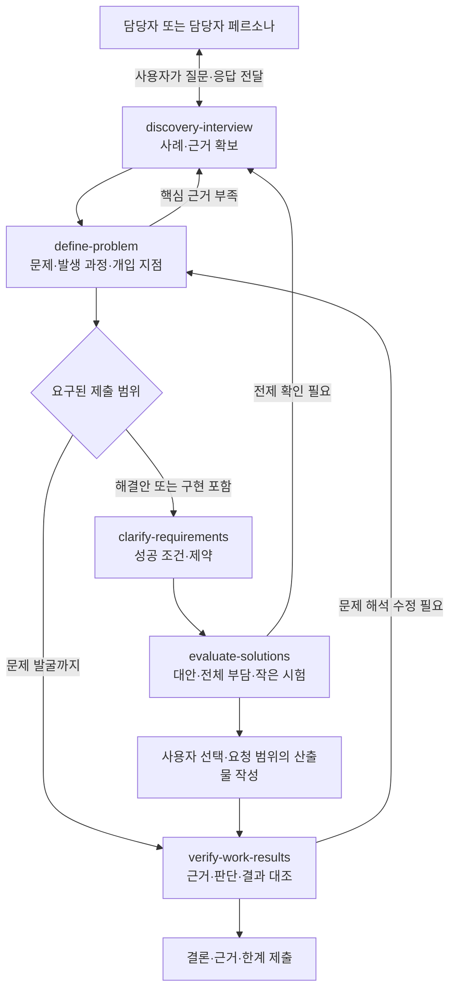

# Product Skill Trees

담당자 인터뷰에서 근거를 확보하고, 문제를 정의하고, 해결안을 비교하고, 결과를 검증하는 **업무·제품 문제 해결 스킬 모음**입니다.

각 스킬은 필요한 단계에서 독립적으로 사용할 수 있습니다. 문제 발굴만 요청받았다면 문제 정의의 근거를 검증하고 마무리하며, 해결안·구현이 필요할 때 해당 단계로 확장합니다.

## 스킬

| 스킬 | 하는 일 | 사용하기 좋은 시점 |
| --- | --- | --- |
| [discovery-interview](skills/discovery-interview/SKILL.md) | 실제 사례·자료·원인·영향을 확보하는 인터뷰 준비와 질문 보완 | 불만이나 기능 요청은 있지만 구체적인 사건과 부담을 모를 때 |
| [define-problem](skills/define-problem/SKILL.md) | 문제·Pain, 원인의 발생 과정, 바꿀 행동·구조의 후보를 연결 | 여러 응답과 자료에서 문제와 개입 지점을 좁힐 때 |
| [clarify-requirements](skills/clarify-requirements/SKILL.md) | 성공 조건·규칙·제약·예외와 검증 기준 정리 | 해결안이 무엇을 만족해야 하는지 정할 때 |
| [evaluate-solutions](skills/evaluate-solutions/SKILL.md) | 실질적으로 다른 대안, 역할별 업무 부담, 작은 실험과 선택 변경 조건 비교 | 여러 방법 중 선택하거나 핵심 가정을 확인할 때 |
| [verify-work-results](skills/verify-work-results/SKILL.md) | 원자료·기준과 결과를 대조하고 검증 주체·방법·범위 기록 | 핵심 주장·계산·산출물의 정확성을 확인할 때 |

`verify-work-results`에는 [설명 연습 모드](skills/verify-work-results/references/learning-mode.md)가 포함되어 있습니다. 학습·복기를 요청한 경우에만 사용자의 최초 설명을 보존하고 근거 중심으로 피드백합니다.

화면 설계·구현으로 이어지는 과제에는 아래 [후속 연계 스킬: 디자인](#후속-연계-스킬-디자인)을 선택해 추가할 수 있습니다.

## 단계별 입력·출력

각 스킬은 정형화된 Markdown 결과를 저장합니다. 기본 위치는 `artifacts/<작업명>/`이며, 사용자 지정 경로·형식을 우선합니다. 이전 단계의 출력은 다음 단계의 입력표에 **문서 링크·버전·항목 ID**로 연결됩니다.

| 스킬 | 출력 | 다음에 전달할 것 |
| --- | --- | --- |
| discovery-interview | `01-discovery.md` | 근거 E-ID, 사례 C-ID, 업무 범위·Pain |
| define-problem | `02-problem-definition.md` | 문제 P-ID → 발생 과정 M-ID → 개입 지점 O-ID |
| clarify-requirements | `03-requirements.md` | P/O와 연결된 요구 R-ID, 검증 기준·충돌 |
| evaluate-solutions | `04-solution-evaluation.md` | 대안 S-ID, 실제 선택 상태, 실험 계획 X-ID |
| verify-work-results | `05-verification.md` | 대조 결과 V-ID, 한계, 돌아갈 문서·항목 |

각 문서에서 핵심 결론·입력·상세 판단·사용자 검토·다음 단계 전달·변경 기록을 확인할 수 있습니다. 사용자 검토는 실제 피드백이 있기 전까지 `미검토`로 남습니다. 문서 작성, 사용자 선택, 실제 검증을 서로 구분하며, 매 단계의 승인을 새 필수 절차로 만들지는 않습니다.

**Problem Space → Pain → Mechanism → Opportunity → Solution**을 판단 내용으로 추적합니다. 특히 Opportunity는 “누구의 어느 행동·구조를 바꿀 것인가”, Solution은 “그 변화를 어떤 구체적인 방법으로 만들 것인가”로 구분합니다. 원인·개입이 잠정이면 다음 단계에서도 가설 상태를 보존합니다.

자세한 규칙과 양식은 [입력·출력 규약](docs/handoff-contract.md), 실제 문서 모양은 [가상 온보딩 예제](docs/examples/onboarding/01-discovery.md)에서 확인할 수 있습니다. 앞 단계 파일이 없어도 직접 자료로 시작하며, 수행하지 않은 단계의 문서는 만들지 않습니다.

## Skill Map

- [인터랙티브 HTML 스킬맵](docs/skill-map.html): 제출 범위 전환, 단계별 질문·완료 기준, 호출 문장 복사, 인쇄·PDF 저장.
- [스킬별 흐름·양식 HTML](docs/skill-guide.html): 다섯 스킬의 내부 진행 흐름, 실제 MD 양식, 가상 작성 예제, 스킬 원문을 전환해서 읽고 Markdown 복사·내려받기.
- [Markdown 스킬맵](docs/skill-map.md): 전체 흐름, 역할 구분, 단계별 사용법과 호출 예시.

HTML은 외부 라이브러리나 네트워크 요청 없이 동작하는 단일 파일입니다. **저장소를 복제하거나 파일을 내려받은 뒤 브라우저에서 열어 주세요.** GitHub 파일 화면에서는 HTML 소스가 표시됩니다. 스킬 원문·Markdown 링크까지 사용하려면 저장소 구조를 함께 유지합니다.

스킬별 안내의 원문·양식·예제는 실제 Markdown을 포함합니다. 해당 파일을 수정했다면 `python3 scripts/build_skill_guide.py`로 HTML을 다시 생성합니다. 별도 패키지는 필요하지 않습니다. 진행 흐름 요약은 같은 스크립트의 `STAGES`에, 화면 구성은 `scripts/templates/skill-guide.html`에 있습니다.



이 지도는 작업과 정보 전달의 흐름입니다. 에이전트를 자동 생성하거나 외부로 질문을 전송하지 않습니다. 검증은 마지막뿐 아니라 인터뷰에서 중요한 수치·주장을 확인하는 중간 단계에도 사용합니다.

## 사용 방법

스킬 파일을 읽을 수 있는 AI 도구에 필요한 `SKILL.md`를 지정합니다. 예를 들어 저장소에서 인터뷰 지원을 요청할 수 있습니다.

```text
skills/discovery-interview/SKILL.md를 읽고 인터뷰를 도와줘.
첨부한 과제와 실제 담당자 응답을 바탕으로
확보한 근거, 내 가설, 아직 모르는 것을 구분해줘.
다음에 물을 핵심 질문 하나와 그 질문으로 달라질 판단을 알려줘.
담당자의 답변이나 수치를 대신 만들어내지 마.
단계 결과는 출력 양식에 맞춰 artifacts/고객온보딩/01-discovery.md에 저장해줘.
```

스킬이 등록된 환경에서는 해당 도구가 지원하는 호출 방식을 사용합니다. 아래는 `$스킬명` 호출을 지원하는 환경의 예시입니다.

```text
$verify-work-results
제출 초안을 실제 응답·자료·규칙과 대조해줘.
개별 판단과 전체 집계를 나누고 기대값의 도출 근거를 남겨줘.
내가 직접 확인한 것, AI만 확인한 것, 미확인 범위를 구분해줘.
```

인터뷰 대상 담당자에게는 자연어 질문을 전달하고, 분석 지원 AI에는 필요한 스킬을 적용합니다. 구체적인 단계별 요청 문장은 [Markdown 스킬맵](docs/skill-map.md)에 있습니다.

## 후속 연계 스킬: 디자인

해결안에 웹 화면이나 제품 UI가 포함될 때 함께 쓰는 외부 스킬입니다. 이 저장소는 두 스킬의 원문·설치 방법·연결 지점을 안내합니다. 저장소를 복제한 뒤 원문을 확인하고, 필요할 때 아래 명령으로 사용하는 프로젝트에 추가할 수 있습니다.

| 스킬 · 제작자 | 사용하기 좋은 시점 | 입력 → 결과 | 원문·설치 현황 |
| --- | --- | --- | --- |
| **frontend-design · Anthropic** | 새 화면을 만들거나 디자인 방향을 바꿀 때 | 대상 사용자·요구사항·선택한 해결안·기존 디자인 → 색상·서체·레이아웃 방향, 화면 코드, 시각적 검토 | [공식 스킬](https://github.com/anthropics/skills/tree/main/skills/frontend-design) · [skills.sh](https://skills.sh/anthropics/skills/frontend-design) |
| **web-design-guidelines · Vercel** | 만든 화면의 사용성과 접근성을 점검할 때 | 화면 코드·검토 범위·최신 지침 → 키보드 조작·포커스·폼·반응형 등의 문제를 `파일:행` 단위로 보고 | [공식 스킬](https://github.com/vercel-labs/agent-skills/tree/main/skills/web-design-guidelines) · [skills.sh](https://skills.sh/vercel-labs/agent-skills/web-design-guidelines) |

### 기존 스킬과 연결하기

```text
03-requirements.md의 R-ID + 04-solution-evaluation.md의 선택한 S-ID
  → frontend-design: 요구와 선택한 방법에 맞춰 화면 설계·구현
  → web-design-guidelines: 화면 코드의 UI 품질 점검
  → 발견한 문제 수정·재점검
  → verify-work-results: 요구사항·원자료와 결과를 대조해 05-verification.md 작성
```

`frontend-design`에는 요구·제약과 실제 선택 상태를 전달합니다. `web-design-guidelines`는 검토할 파일·범위를 지정하며, 실행할 때 원본 저장소의 최신 지침을 가져옵니다. UI 점검의 통과와 업무 효과 입증은 구분합니다.

외부 스킬의 기본 결과 형식은 각각 다릅니다. 이 저장소의 MD 흐름과 연결할 때는 디자인 결정·화면 파일 경로·UI 점검 결과·미확인을 남기고, `05-verification.md`의 입력표에 해당 자료와 관련 R/S-ID를 연결합니다.

### 필요할 때 설치하기

아래 명령은 **실제로 디자인 작업을 할 프로젝트 폴더**에서 실행합니다. 이 저장소 자체의 HTML을 개선할 경우에는 복제한 `product-skill-trees` 폴더에서 실행하면 됩니다. 현재 Skills CLI는 Node.js 22.20 이상을 요구합니다. [설치 안내](https://github.com/vercel-labs/skills#install-a-skill)

```bash
npx skills add anthropics/skills --skill frontend-design -a codex
npx skills add vercel-labs/agent-skills --skill web-design-guidelines -a codex
```

기본 설치 범위는 해당 프로젝트이며 Codex의 프로젝트 스킬 경로는 `.agents/skills/`입니다. 여러 프로젝트에서 공통으로 쓰려면 각 명령에 `-g`를 추가합니다. [설치 옵션](https://github.com/vercel-labs/skills/blob/main/docs/commands.md#skills-add) · [Codex 설치 경로](https://github.com/vercel-labs/skills/blob/main/docs/agents.md)

설치 후에는 다음과 같이 요청할 수 있습니다. 경로는 실제 작업 폴더에 맞게 바꿉니다.

```text
$frontend-design
artifacts/고객온보딩/03-requirements.md와 04-solution-evaluation.md를 읽고,
선택된 해결안의 화면을 설계·구현해줘.
대상 사용자·기존 디자인·R-ID의 요구와 제약을 보존하고,
디자인 결정과 연결된 R/S-ID, 구현 파일 경로, 확인한 범위를
artifacts/고객온보딩/design-notes.md에 남겨줘.
```

```text
$web-design-guidelines
구현한 화면 파일을 최신 지침으로 검토해줘.
파일·행별 문제와 검토 범위·미확인을
artifacts/고객온보딩/ui-review.md에 남겨줘.
```

## 적용 원칙

- 원문 사실, 담당자 진술, 해석·가설, 개선 제안을 구분합니다.
- 사용자가 정한 범위와 이미 확정한 조건을 보존합니다. 모든 스킬을 순서대로 호출하도록 강제하지 않습니다.
- 사례별 정확성과 전체 자료의 정합성을 각각 확인합니다. 표본 검사를 전체 검증으로 확대하지 않습니다.
- 기능 시험, 업무 원기록 대조, 실제 운영 효과 확인을 구분합니다.
- 한 사람의 업무가 줄어든 만큼 다른 사람에게 입력·갱신·예외 처리 업무가 생기는지도 살핍니다.
- 시험·가상 과제의 응답은 과제 내 근거로 다루며, 실제 기업의 현장 증거로 표현하지 않습니다. 사용 도구·자료·제출 범위는 해당 환경의 지침을 따릅니다.

## 파일 구성

```text
product-skill-trees/
├── README.md
├── LICENSE
├── docs/
│   ├── skill-map.html
│   ├── skill-guide.html
│   ├── skill-map.md
│   ├── handoff-contract.md
│   └── examples/onboarding/   # 가상 입력과 단계별 출력 예제
├── scripts/build_skill_guide.py  # 실제 Markdown으로 안내 HTML 생성
└── skills/
    ├── discovery-interview/
    │   ├── SKILL.md
    │   └── agents/openai.yaml
    ├── define-problem/SKILL.md
    ├── clarify-requirements/SKILL.md
    ├── evaluate-solutions/SKILL.md
    └── verify-work-results/
        ├── SKILL.md
        ├── agents/openai.yaml
        └── references/learning-mode.md
```

다섯 스킬 폴더에는 각각 `assets/output-template.md`가 있습니다. 사용자 작업 결과를 저장하는 `artifacts/`는 Git에서 제외됩니다.

스킬 본문은 로컬 스킬의 현재 내용을 담고, 문서는 다른 환경에서도 읽을 수 있도록 저장소 상대 경로를 사용합니다. 개인 학습 원기록은 포함하지 않습니다.

[MIT License](LICENSE)
