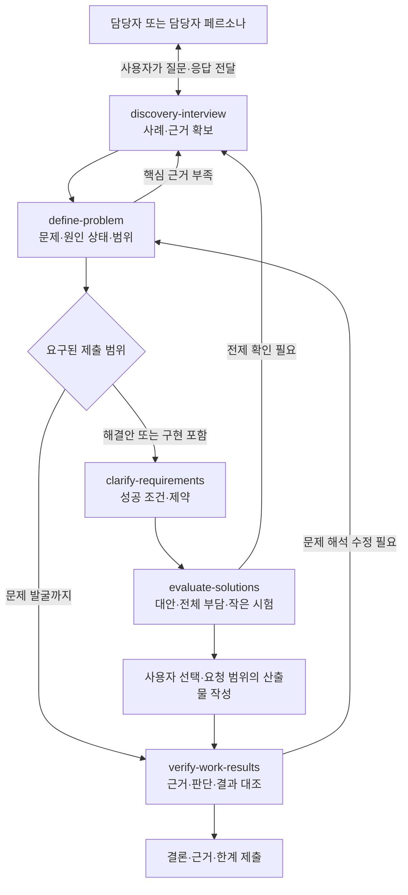

# Product Skill Trees

담당자 인터뷰에서 근거를 확보하고, 문제를 정의하고, 해결안을 비교하고, 결과를 검증하는 **업무·제품 문제 해결 스킬 모음**입니다.

각 스킬은 필요한 단계에서 독립적으로 사용할 수 있습니다. 문제 발굴만 요청받았다면 문제 정의의 근거를 검증하고 마무리하며, 해결안·구현이 필요할 때 해당 단계로 확장합니다.

## 스킬

| 스킬 | 하는 일 | 사용하기 좋은 시점 |
| --- | --- | --- |
| [discovery-interview](skills/discovery-interview/SKILL.md) | 실제 사례·자료·원인·영향을 확보하는 인터뷰 준비와 질문 보완 | 불만이나 기능 요청은 있지만 구체적인 사건과 부담을 모를 때 |
| [define-problem](skills/define-problem/SKILL.md) | 현상·영향·원인 가설을 구분하고 문제와 범위를 정의 | 여러 응답과 자료에서 이번에 해결할 문제를 좁힐 때 |
| [clarify-requirements](skills/clarify-requirements/SKILL.md) | 성공 조건·규칙·제약·예외와 검증 기준 정리 | 해결안이 무엇을 만족해야 하는지 정할 때 |
| [evaluate-solutions](skills/evaluate-solutions/SKILL.md) | 실질적으로 다른 대안, 역할별 업무 부담, 작은 실험과 선택 변경 조건 비교 | 여러 방법 중 선택하거나 핵심 가정을 확인할 때 |
| [verify-work-results](skills/verify-work-results/SKILL.md) | 원자료·기준과 결과를 대조하고 검증 주체·방법·범위 기록 | 핵심 주장·계산·산출물의 정확성을 확인할 때 |

`verify-work-results`에는 [설명 연습 모드](skills/verify-work-results/references/learning-mode.md)가 포함되어 있습니다. 학습·복기를 요청한 경우에만 사용자의 최초 설명을 보존하고 근거 중심으로 피드백합니다.

## Skill Map

- [인터랙티브 HTML 스킬맵](docs/skill-map.html): 제출 범위 전환, 단계별 질문·완료 기준, 호출 문장 복사, 인쇄·PDF 저장.
- [Markdown 스킬맵](docs/skill-map.md): 전체 흐름, 역할 구분, 단계별 사용법과 호출 예시.

HTML은 외부 라이브러리나 네트워크 요청 없이 동작하는 단일 파일입니다. **저장소를 복제하거나 파일을 내려받은 뒤 브라우저에서 열어 주세요.** GitHub 파일 화면에서는 HTML 소스가 표시됩니다. 스킬 원문·Markdown 링크까지 사용하려면 저장소 구조를 함께 유지합니다.



이 지도는 작업과 정보 전달의 흐름입니다. 에이전트를 자동 생성하거나 외부로 질문을 전송하지 않습니다. 검증은 마지막뿐 아니라 인터뷰에서 중요한 수치·주장을 확인하는 중간 단계에도 사용합니다.

## 사용 방법

스킬 파일을 읽을 수 있는 AI 도구에 필요한 `SKILL.md`를 지정합니다. 예를 들어 저장소에서 인터뷰 지원을 요청할 수 있습니다.

```text
skills/discovery-interview/SKILL.md를 읽고 인터뷰를 도와줘.
첨부한 과제와 실제 담당자 응답을 바탕으로
확보한 근거, 내 가설, 아직 모르는 것을 구분해줘.
다음에 물을 핵심 질문 하나와 그 질문으로 달라질 판단을 알려줘.
담당자의 답변이나 수치를 대신 만들어내지 마.
```

스킬이 등록된 환경에서는 해당 도구가 지원하는 호출 방식을 사용합니다. 아래는 `$스킬명` 호출을 지원하는 환경의 예시입니다.

```text
$verify-work-results
제출 초안을 실제 응답·자료·규칙과 대조해줘.
개별 판단과 전체 집계를 나누고 기대값의 도출 근거를 남겨줘.
내가 직접 확인한 것, AI만 확인한 것, 미확인 범위를 구분해줘.
```

인터뷰 대상 담당자에게는 자연어 질문을 전달하고, 분석 지원 AI에는 필요한 스킬을 적용합니다. 구체적인 단계별 요청 문장은 [Markdown 스킬맵](docs/skill-map.md)에 있습니다.

## 적용 원칙

- 원문 사실, 담당자 진술, 해석·가설, 개선 제안을 구분합니다.
- 사용자가 정한 범위와 이미 확정한 조건을 보존합니다. 모든 스킬을 순서대로 호출하도록 강제하지 않습니다.
- 사례별 정확성과 전체 자료의 정합성을 각각 확인합니다. 표본 검사를 전체 검증으로 확대하지 않습니다.
- 기능 시험, 업무 원기록 대조, 실제 운영 효과 확인을 구분합니다.
- 한 사람의 업무가 줄어든 만큼 다른 사람에게 입력·갱신·예외 처리 업무가 생기는지도 살핍니다.
- 시험·가상 과제의 응답은 과제 내 근거로 다루며, 실제 기업의 현장 증거로 표현하지 않습니다. 사용 도구·자료·제출 범위는 해당 환경의 지침을 따릅니다.

## 파일 구성

```text
product-skill-trees/
├── README.md
├── LICENSE
├── docs/
│   ├── skill-map.html
│   └── skill-map.md
└── skills/
    ├── discovery-interview/
    │   ├── SKILL.md
    │   └── agents/openai.yaml
    ├── define-problem/SKILL.md
    ├── clarify-requirements/SKILL.md
    ├── evaluate-solutions/SKILL.md
    └── verify-work-results/
        ├── SKILL.md
        ├── agents/openai.yaml
        └── references/learning-mode.md
```

스킬 본문은 로컬 스킬의 현재 내용을 담고, 문서는 다른 환경에서도 읽을 수 있도록 저장소 상대 경로를 사용합니다. 개인 학습 원기록은 포함하지 않습니다.

[MIT License](LICENSE)
