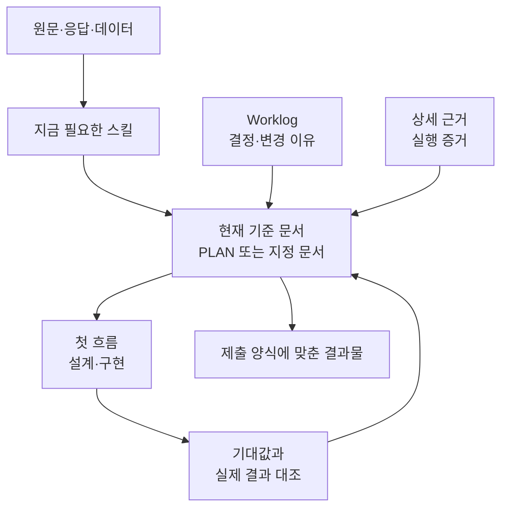

# 현재 기준 문서에서 개발·제출로

`PLAN.md`의 역할은 **사람이 현재 방향을 이해하고 개발자가 구현 기준을 찾는 입구**다. 단계 산출물을 모두 복사한 최종 보고서가 아니다. 처음부터 완성본을 만들기보다 필요한 스킬의 결과를 해당 절에 반영하고 구현·검증으로 갱신한다.

## 무엇을 어디에 쓸까

| 위치 | 관리할 내용 | 갱신 책임·시점 |
| --- | --- | --- |
| 현재 기준 문서, 기본 `docs/PLAN.md` | 목표·문제·선택 이유·필수/후속·요구·최소 설계·현재 검증·다음 행동 | 에이전트가 의미 있는 결정·진행 변화 때 갱신 |
| `docs/WORKLOG.md` | 실제 질문·응답·선택·위임·변경 이유·실행 결과 링크, D-ID | 에이전트가 의미 있는 응답 종료 전 기록 |
| 필요할 때만 상세 자료 | 긴 원자료·비교·설계 계약·실행 증거 또는 별도 제출이 필요한 단계 결과 | 해당 내용의 원본 한 곳만 갱신 |
| 과제 지정 제출본 | 제출 양식에 맞춘 현재 결과·근거·한계 | 기준 리비전에서 작성하고 제출 전 영향 항목 대조 |

규칙의 원본은 [공통 AGENTS](../templates/AGENTS.template.md), 기본 구조는 [PLAN 양식](../templates/PLAN.template.md)이다. 실제 과제에서 이 역할을 맡을 지정 문서가 있으면 그 문서를 사용한다. 이름이 PLAN일 필요는 없다. 작업 규칙 `AGENTS.md`와 결정 이력 Worklog는 제품 요구·설계의 두 번째 원본이 아니다. 병렬 작업에서는 위 표의 기준 문서·Worklog 갱신을 메인 에이전트가 맡는다. 서브는 배정된 실제 작업과 검사를 수행하고 결과·증거·질문을 메인에게 전달한다.

## 기본: 스킬 결과를 한 문서에 통합

사람은 기준 문서의 **지금 알아야 할 것**부터 읽는다. 목표·선택 이유·필수 범위·완료 증거·차단·다음 작업을 짧게 보여주고, 개발 기준은 아래 요구·설계·검증 절에서 찾는다. 상세 문서는 판단 근거를 더 확인할 때만 연다. 수행하지 않은 단계는 만들지 않으며 한 스킬만 요청된 작업에 PLAN을 강제하지 않는다.

현재 판단의 원본을 한 곳으로 정한다. 통합 관리에서는 PLAN의 요구표·선택 근거·설계·검증 절이 원본이다. 이미 `03-requirements.md`를 상세 요구의 원본으로 쓰고 있다면 그 표를 유지하고 PLAN에는 중요한 요구와 링크만 둔다. **같은 전체 표를 두 곳에서 수정하지 않는다.** 독립적으로 이해할 핵심 설명은 남기되 인용·분석·실행 로그를 전부 합치지 않는다.

이전 단계 문서를 한꺼번에 삭제하거나 이동할 필요는 없다. 현재도 관리하는 상세 원본인지 당시 분석 기록인지 표시하고, 현재 기준 문서의 관리 위치에 연결한다. 당시 기록의 최초 판단은 보존한다. 변경된 현재 판단은 원본·요약·영향받는 검증 상태에 반영하며, 오래된 문서 전체를 매번 고치지 않는다.

## 최소 설계와 구현 전환

첫 흐름의 필수 동작·기대 결과·입출력·차단 결정 처리 방법이 정해지면 준비된 범위부터 구현한다. `착수 차단 / 구현 중 결정 / 후속 후보`를 구분하고, 선택 기능·문장 다듬기·모든 기술값 확정을 기다리지 않는다. 설계·구현 권한은 실제 요청·선택·위임에서 확인하며 문서 작성 완료와 구분한다.

화면이 있는 제품은 [design-ux](../skills/design-ux/SKILL.md)로 사용자 흐름·화면·상태·복구를, 데이터·처리가 필요한 소프트웨어는 [design-backend](../skills/design-backend/SKILL.md)로 모듈 책임·저장·권한·변경 동작을 구체화한다. PLAN의 관련 설계 절에 흐름도와 해설을 두고 공유 입출력을 대조한다. 필요한 설계만 수행하며 설계 요청을 구현으로 확대하지 않는다. 병렬 작업이 요청됐으면 [스킬맵의 병렬 진행 조건](skill-map.md#ux와-백엔드-설계의-병렬-진행)에 따라 메인이 PLAN과 공유 계약을 관리하고 태스크별로 작업을 배정한다.

예를 들어 노선 재생성은 “새 노선이 만들어짐” 외에 기존 배정·조회가 언제 바뀌는지까지 결정해야 한다. 이것이 초안·운영본·이력을 모두 만들라는 뜻은 아니다. 즉시 교체가 요구를 만족하면 그 선택과 실패 시 보존 조건을 명시하면 된다.

## 제출 문서를 깔끔하게 유지하는 방법

| 과제 조건 | 관리 방식 |
| --- | --- |
| 지정 문서가 계획·설계이고 작업 중 수정 가능 | 그 문서를 기준 문서로 사용. 별도 PLAN 사본 없음 |
| 제출 형식·분량이 엄격한 보고서·서술형 | PLAN에서 제출본을 편집. 계획 중 메모·대화·로그를 그대로 넣지 않음 |
| 단계별 문서가 각각 필수 제출물 | 지정 문서를 각 내용의 원본으로 유지. PLAN은 현재 핵심·다음 행동과 링크만 |
| 단독 인터뷰·요구 검토 | 해당 결과 문서만 작성. 별도 종합 계획 불필요 |

시작할 때 제출 항목을 기준 문서의 절·증거와 연결한다. 제출본을 작성한 뒤에는 사용한 리비전·시점·마지막 대조 상태를 기준 문서에 남긴다. 이후 변경은 현재 원본에 먼저 반영하고 영향을 받는 제출 항목만 다시 편집한다. 제출본에서 받은 수정도 원본으로 되돌려 반영한다. 두 문서를 독립적으로 계속 갱신하지 않는다. 문서 작성·대조·실제 제출 확인은 서로 다른 상태다.

셋업이 만든 빈 PLAN이 필요 없으면 실제 기준 문서의 위치를 안내하는 용도로만 둔다. 지정된 원문·읽기 전용 템플릿을 작업 메모로 수정하지 않는다.

## 웹 제품의 검토 결과 연결

작은 검사는 기준 문서의 검증 절에 [공통 양식](../templates/AGENTS.template.md#웹-제품의-화면-검토브라우저-테스트-기록)으로 남긴다. 기록이 길거나 별도 제출이 필요할 때만 `ui-review.md`, `browser-test-results.md`, `05-verification.md` 중 필요한 문서를 분리한다.

- 코드·시각 검토와 실제 조작을 구분하고 R-ID → 검사/증거 → 현재 판정으로 연결한다.
- 상세 05가 검증 원본이면 PLAN에는 결론·한계·링크만 둔다. 같은 검사표를 다시 복사하지 않는다.
- 로그인 → 후속 조회, 생성 → 변경·재생성, 실패 전후 기존 상태 보존 중 관련 흐름을 실제 환경에서 확인한다.
- 수정 전 실패와 수정 후 같은 경로의 재검사를 연결한다. 환경이 다르거나 사용자 재확인이 없으면 그 부분은 미확인으로 남긴다.
- 현재 요약·증거 취합은 에이전트가 수행한다. 사용자가 모든 검사 기록을 읽고 조합하게 하지 않는다.

## 시간과 재개

마감이 있는 과제는 [시간 지침](../templates/AGENTS.template.md#시간-제한이-있는-과제)에 따라 검증·설명·제출 시간을 먼저 남긴다. 실제 시각·남은 시간으로 정리 종료와 첫 실행 시점을 정하고, 단계 전환·대기 종료·재개 때 조정한다. 이전 시험의 180분이나 대화 횟수를 새 과제에 적용하지 않는다.

재개 시 기준 문서의 현재 요약·원본 위치와 Worklog의 관련 최신 결정을 읽고, 필요한 근거만 추가로 확인한다. 이전에 끝낸 단계를 반복하거나 모든 문서를 읽는 일을 새 착수 조건으로 만들지 않는다.

셋업은 문서 7개와 핵심 스킬 7개를 준비하며 기존 문서·스킬은 보존한다. 배포용 [Worklog](WORKLOG.md)는 기록 없는 양식이다. [설치 안내](../README.md#설치와-업데이트) · [요청 문구](../PROMPTS.md)
