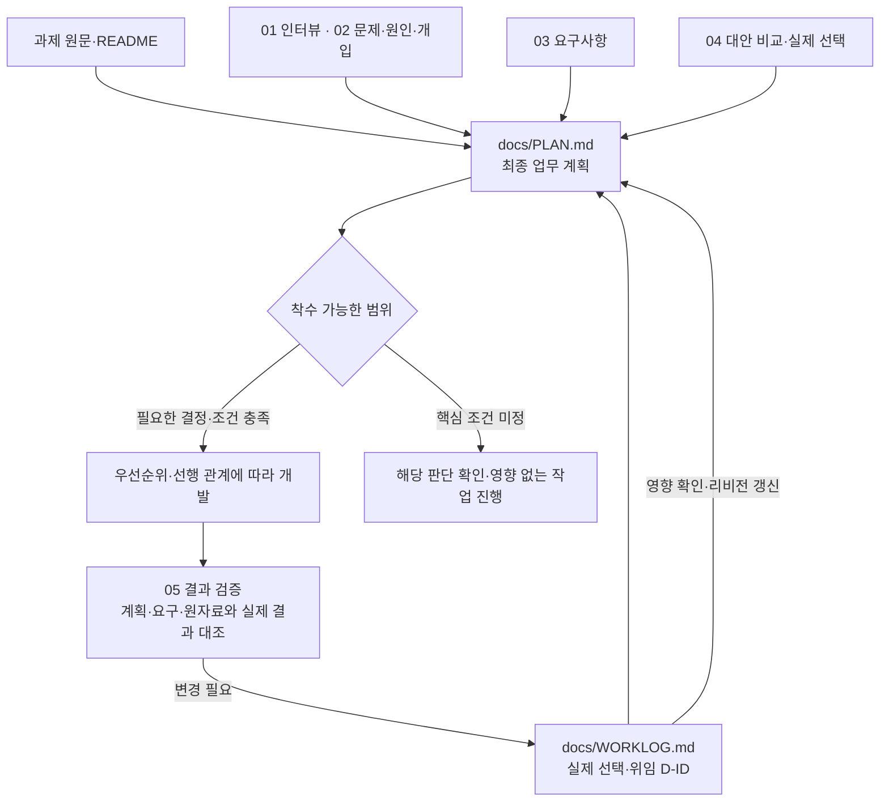

# 최종 업무 계획과 개발 착수

`PLAN.md`는 인터뷰와 분석의 핵심 판단을 하나로 묶어 개발자가 **누구의 무엇을 왜, 어떤 순서로 만들고 어떻게 확인할지** 이해하게 하는 최종 업무 계획이다. 단계별 원자료·분석·결정 이력은 각각 보존하고, PLAN에는 실행에 필요한 핵심 내용을 직접 서술한다.

## 세 문서의 역할

| 문서 | 역할 | 작성·갱신 시점 |
| --- | --- | --- |
| 과제의 `AGENTS.md` | 작업 범위·검증·데이터·보고·커밋·기록 규칙 | 과제 시작, 실제 규칙 변경 시 |
| `docs/WORKLOG.md` | 시각·상대·내용·결정·근거, D-ID로 현재 사용자의 협업·작업 이력 보존 | 에이전트가 별도 요청 없이 의미 있는 응답 종료 전에 기록 |
| `docs/PLAN.md` | 목표·문제·요구·채택 솔루션·제외·우선순위·단계별 산출물과 검증을 종합 | 해결안 선택 후 계획 작성·구현 요청 시, 관련 입력·결정 변경 시 |

작업 규칙의 원본은 [공통 규칙](../templates/AGENTS.template.md)이며, 실제 과제에는 이 파일을 `AGENTS.md`로 복사한다. 저장소 루트의 [AGENTS.md](../AGENTS.md)는 공통 규칙 전체를 읽도록 지시하고 저장소 정비 규칙만 추가한다. [최종 계획 양식](../templates/PLAN.template.md)과 [Worklog 양식](../templates/WORKLOG.template.md)도 함께 사용한다. 배포되는 [WORKLOG.md](WORKLOG.md)는 기록 행이 없는 상태이며 현재 사용자와의 실제 과제 협업부터 채운다.

## 단계 산출물을 종합하는 방법

1. 과제의 목표·필수 조건·제출물·파일명을 먼저 고정한다.
2. 01·02에서 타겟 사용자, 실제 문제, 이번 문제, M/O 가설의 상태를 가져온다.
3. 03에서 R-ID와 결과 조건·예외·검증 기준을 가져온다.
4. 04와 협업 기록에서 실제 채택한 S-ID, 선택 이유·감수할 대가·남은 전제를 가져온다. AI 추천을 사용자 선택으로 바꾸지 않는다.
5. 채택 솔루션의 우선순위를 사용자 결정·필수 조건·선행 관계로 정리한다. 필요하면 S-ID 아래 U-ID 구현 단위를 나누고, 단계별 변경 파일·산출물·검증 방법·기대 판단을 적는다.
6. 제외 범위, 구현 환경·입력·운영 조건, 미해결 질문과 착수 가능한 부분을 명시한다.
7. PLAN의 입력표에 사용한 버전·기존 ID·D-ID를 기록하고 실제 근거와 대조한다. 05가 이미 있으면 관련 결과를 반영하지만 구현 검증이 끝날 때까지 계획을 작성하지 못하게 막지는 않는다.

앞 단계 파일은 모두 필수인 체크리스트가 아니다. 충분한 직접 근거가 있으면 해당 입력을 명시한다. 기존 ID가 없으면 PLAN 안에서 필요한 P/R/S-ID를 정의하고 실제 출처를 연결한다. 수행하지 않은 상위 문서를 만들어 참조하지 않는다. 문제 발굴만 요청됐거나 아직 해결안 선택 전이라면 기존 범위의 결과를 정리하고, 개발 확정 계획으로 표시하지 않는다.

## 확정 계획과 실제 실행을 구분

`초안`은 아직 필요한 선택·조건이 정해지지 않은 상태다. `확정`은 과제 조건과 실제 선택·위임 범위에 맞춰 실행 계획을 정리한 상태이며, 사용자의 직접 검토나 운영 효과 검증까지 끝났다는 뜻은 아니다. 사용자 검토는 실제 피드백이 있을 때만 갱신한다.

사용자가 전체 진행을 맡겼고 필요한 판단이 이미 정해졌다면 새로운 승인 절차를 추가하지 않는다. 결정이 없거나 충돌하면 영향을 받는 구현만 보류하고 가능한 계획·검증을 계속한다. 변경된 입력이나 결정이 계획을 바꾸면 해당 부분을 `재검토 필요`로 표시한 뒤 실제 영향 검토와 함께 갱신한다.

예를 들어 S-01과 S-02가 서로 다른 대안이었다면, S-01만 채택한 뒤 두 대안을 각각 1·2순위로 개발 목록에 넣지 않는다. S-01을 `U-01 상태 입력`, `U-02 상태 조회`로 나누는 것도 해당 기능이 실제 선택 범위에 있을 때만 한다.

## 웹 제품의 검토 결과 연결

웹 제품 개발에서는 작업 대상·화면·기능을 PLAN의 R-ID와 채택한 S-ID에 연결한다. U-ID가 있으면 부모 S-ID도 유지한다. 외부 스킬·플러그인·MCP의 결과에도 [공통 기록 규칙과 Markdown 양식](../templates/AGENTS.template.md#웹-제품의-화면-검토브라우저-테스트-기록)을 적용한다. 이 양식은 셋업으로 과제의 `AGENTS.md`에 포함되므로 별도 양식 다운로드가 필요 없다.

| 기록 위치 | 담을 내용 | 후속 연결 |
| --- | --- | --- |
| `artifacts/<작업명>/ui-review.md` | 화면 코드·시각적 검토의 시나리오·기대 결과·실제 결과·증거·미확인, UI-ID | PLAN R/S-ID → 05의 V-ID |
| `artifacts/<작업명>/browser-test-results.md` | 실제 브라우저 조작의 시나리오·기대 결과·실제 결과·증거·미확인, BT-ID | PLAN R/S-ID → 05의 V-ID |
| 같은 작업의 `05-verification.md` | 검토 문서·리비전·확인 ID와 연결한 요구 충족 판단·한계 | 실패·공백에 따른 수정 또는 추가 검증 |
| `docs/WORKLOG.md` | 결정·변경 이유·관련 R/S/V-ID·산출물 링크, D-ID | PLAN과 영향받는 검증 기준 갱신 |

과제 지정 경로와 기존 문서를 우선하며, 요청·수행한 범위만 기록한다. 화면이 표시된 것과 버튼·입력·이동이 동작한 것을 구분하고, 실행하지 못한 검사는 `미실행`과 이유를 남긴다. 수정 후 재검사 기록을 추가하며 이전 실패나 결정은 지우지 않는다. 상세 실행 기록·검증 판단·결정 이력은 위 위치에 나누어 두고 본문을 중복 복사하지 않는다.

## Worklog를 자동으로 남기는 기준

표는 `시각 | 상대(담당자/Codex/나) | 내용 | 결정 | 근거` 다섯 열을 유지한다. 에이전트가 별도 요청 없이 실제 질문·답변·결정·수행 작업·검증 결과를 응답 종료 전에 추가한다. 중요한 질문·답변도 결정이 없으면 `미결정`으로 기록한다. 과거의 제안과 이후의 실제 채택은 다른 D-ID로 연결한다. 기존 기록은 보존하고 동일 사건을 중복 기록하지 않는다.

자동 기록은 AGENTS 지침을 읽은 에이전트가 협업 중 수행하는 파일 갱신이다. 셋업이 대화를 수집하거나 백그라운드 기록 프로그램을 실행하는 것은 아니다. 기록할 수 없는 환경이면 그 사실을 알리고 같은 표 형식으로 대화에 제공한다.

PLAN에는 현재 유효한 결정의 핵심 내용과 D-ID를 적고, 모든 대화 이력을 반복 복사하지 않는다. 의미·범위·우선순위가 바뀌면 기록 → PLAN 영향 확인 → 관련 단계·검증 기준 갱신 순서로 진행한다.

## 시작하기

저장소를 복제한 뒤 실제 과제 폴더에서 `bash /복제한/경로/product-skill-trees/setup.sh`를 실행한다. 문서 7개와 핵심 스킬 5개를 준비하며 스킬은 `.agents/skills/`에 설치된다. 빈 양식은 초안·미검토 상태이고, 기존 문서·스킬은 보존한다. 설치 대상과 충돌 처리는 [설치 안내](../README.md#설치와-업데이트)를 따른다.

[PROMPTS.md](../PROMPTS.md)의 협업 시작 → 최종 계획 작성 → 계획에 따른 개발 문구를 필요한 범위에 맞춰 사용한다. 에이전트는 현재 상황에 필요한 스킬을 골라 이유를 알리고 단계 결과를 저장한다. 대화를 재개할 때는 Worklog의 작업명·산출물 경로·진행 상태·다음 행동, PLAN과 관련 결과를 읽는다. 이미 끝낸 단계를 반복하지 않고 변경된 입력이 영향을 주는 부분만 재검토한다.
