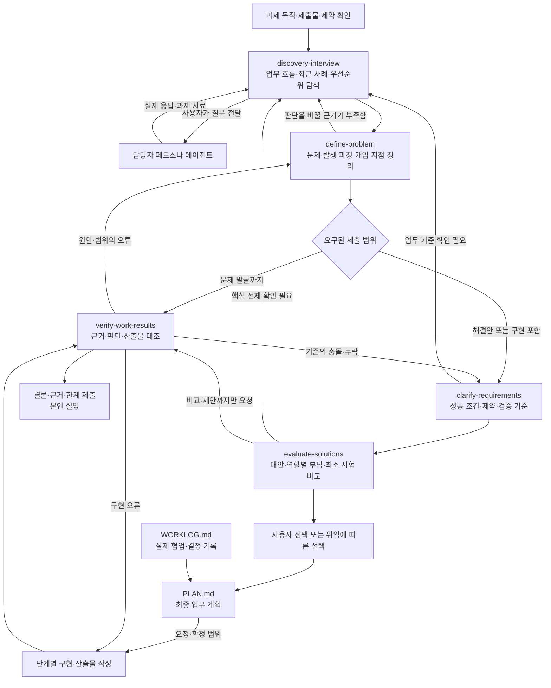

# Skill Map — 사용 시점·흐름·입출력

작성일: 2026-10-30

담당자 또는 담당자 페르소나와 인터뷰하여 업무 문제를 발굴하는 상황에 적용할 운영안이다. 문제 발굴부터 해결안 비교·결과 검증까지 필요한 단계만 사용한다. 시험·가상 과제에서는 제공된 응답과 자료를 과제 내 근거로 다루고, 도구·자료 사용과 제출 범위는 해당 환경의 지침을 따른다. 공식 출제 유형이나 평가표를 재현한 자료가 아니다.

**핵심 흐름은 ‘근거 확보 ↔ 문제·원인·개입 지점 정의 → 성공 조건 → 대안 선택 → 결과 검증’이다.** 문제 발굴만 요구되면 문제 정의의 근거를 검증하고 제출한다. 대안·구현까지 요구될 때만 그 단계로 확장한다. 다섯 스킬을 매번 처음부터 모두 실행할 필요는 없다.

판단 내용은 **Problem Space → Pain → Mechanism → Opportunity → Solution**으로 연결한다. 업무와 불편을 구분하고, 원인이 불편을 만드는 과정을 설명한 뒤, 바꿀 역할·행동·구조를 특정하고 구체적인 방법을 비교한다. 성공 조건은 이 변화가 만족해야 할 기준이며 Opportunity를 대신하지 않는다.

각 단계의 결과는 정형 Markdown으로 저장하고 다음 단계의 입력에 파일·버전·항목 ID로 연결한다. [입력·출력 규약](handoff-contract.md)과 아래 단계별 원문·양식 링크를 참고한다.

## 전체 흐름



이 도식은 **작업 순서와 정보 전달 관계**다. 여러 에이전트를 자동 생성하거나 담당자에게 자동으로 메시지를 보내는 구성이 아니다. 선택된 해결책의 업무 효과에 반대 증거가 나오면 `evaluate-solutions`로 돌아가 선택을 재검토한다.

## 담당자와 지원 AI의 역할

| 역할 | 하는 일 | 근거로 남길 것 |
| --- | --- | --- |
| 나 | 질문 선택·전달, 핵심 판단, 대안 선택, 직접 검증·설명 | 선택 이유, 직접 대조한 사례, 판단 변경 근거 |
| 담당자 페르소나 에이전트 | 과제에서 부여된 업무 사실·경험·제약에 응답 | 실제 발언과 제공 자료. 과제 내 진술·자료로 표시 |
| 분석 지원 AI | 스킬에 따라 질문 보완, 근거 정리, 계산·대안·검증 지원 | 해석·가설·계산·검사와 근거. 담당자 응답을 대신 만들지 않음 |

별도 지원 AI가 허용되는 환경에서는 여기에 스킬을 적용하고, 담당자에게는 자연어 질문을 전달한다. 담당자에게 스킬 이름을 보낸다고 그 환경에 로컬 파일이 로드되는 것으로 가정하지 않는다. 로컬 스킬을 쓸 수 없는 환경에서는 시험 지침에 따라 미리 익힌 질문·판단 순서를 적용한다. 파일 반입이나 지침 붙여넣기가 허용된다고 추정하지 않는다.

## 단계별 흐름과 출력 양식

기본 저장 위치는 `artifacts/<작업명>/`이다. 사용자 지정 경로·형식을 우선한다. 모든 출력은 문서 정보·검토 요약·사용한 입력·단계별 판단·사용자 검토·다음 단계 전달·변경 기록을 갖는다. 입력 링크·리비전·항목 ID와 가설 상태를 유지하고, 실제 피드백 전까지 사용자 검토는 `미검토`로 남긴다.

| 단계 | 출력 MD | 전달할 항목 |
| --- | --- | --- |
| 1. discovery-interview | `01-discovery.md` | E 근거 · C 사례 |
| 2. define-problem | `02-problem-definition.md` | P 문제 · M 발생 과정 · O 개입 지점 |
| 3. clarify-requirements | `03-requirements.md` | R 요구 · P/O 연결 · 검증 기준 |
| 4. evaluate-solutions | `04-solution-evaluation.md` | S 대안 · X 실험 계획 · 실제 선택 상태 |
| 5. verify-work-results | `05-verification.md` | V 대조 결과 · 한계 · 돌아갈 문서·항목 |

문제 발굴의 일반 경로는 01 → 02 → 05이며, 이미 충분한 근거가 있는 단계는 생략한다. 검증은 어느 단계에서도 사용할 수 있다. 앞 단계 파일이 없어도 직접 자료로 시작하며, 수행하지 않은 문서를 만들지 않는다.

### 1. discovery-interview — 인터뷰로 근거 모으기

[스킬 원문](../skills/discovery-interview/SKILL.md) · [실제 MD 양식](../skills/discovery-interview/assets/output-template.md)

- **사용 시점:** 불편하다는 말은 있지만, 실제로 어떤 일이 있었는지 아직 모를 때
- **입력:** 과제 · 실제 담당자 응답 · 업무 자료 · 기존 인터뷰 기록
- **출력:** `01-discovery.md` — E 근거 · C 사례

**내부 진행 순서**

1. **탐색할 업무를 정한다.** 누구의 어느 업무인지, 시작과 완료, 이번에 다룰 범위를 확인합니다.
2. **최근 사례의 앞뒤를 따라간다.** 계기 → 필요한 판단 → 행동·도구·인계 → 결과를 묻습니다. 질문은 한 번에 하나씩 합니다.
3. **깊게 볼 문제와 다른 설명을 찾는다.** 빈도·영향·부담을 근거로 우선순위를 좁히고, 문제가 없던 사례와 차이를 확인합니다.
4. **사실·해석·미확인을 나누어 남긴다.** 실제 발언·자료는 E-ID, 사건 흐름은 C-ID로 기록합니다. 다음 질문으로 어떤 판단이 달라질지도 적습니다.

**양식의 상세 항목:** Problem Space와 Pain · 근거 목록 · 사례와 발생 과정 · 원인·개입 탐색 단서.

**내가 확인할 점**

- 담당자의 말과 내 가설이 구분되어 있는가?
- 직접 작업시간과 답변 대기시간을 나눴는가?
- 다음 질문이 문제 범위나 원인 판단을 바꾸는가?

**질문 예시:** 가장 최근에 진행 상태를 다시 확인했던 일을 하나 말씀해 주세요.

**넘어갈 기준:** 누구의 어느 업무 장면을 더 살필지 정할 수 있습니다. 사례가 하나뿐이라면 반복성은 아직 미확인으로 둡니다.

**돌아가거나 보완할 때:** 사례나 근거가 부족하면 같은 업무 장면의 실제 행동을 더 묻습니다. 지원 AI가 담당자 답변을 만들어 채우지 않습니다.

**다음 연결:** `define-problem` — E/C 근거로 문제·원인·개입을 정리 / `verify-work-results` — 중요한 주장·수치를 먼저 확인

### 2. define-problem — 문제와 바꿀 지점 연결하기

[스킬 원문](../skills/define-problem/SKILL.md) · [실제 MD 양식](../skills/define-problem/assets/output-template.md)

- **사용 시점:** 응답과 자료는 모였지만 무엇이 문제이고 어디를 바꿔야 할지 불분명할 때
- **입력:** 01의 E/C-ID · 업무 범위 · Pain · 추가 질문, 또는 직접 자료
- **출력:** `02-problem-definition.md` — P 문제 · M 발생 과정 · O 개입 지점

**내부 진행 순서**

1. **문제와 영향을 좁힌다.** 누가 어떤 상황에서 어떤 판단·행동에 막히는지, 근거가 지지하는 범위만 P-ID로 진술합니다.
2. **발생 과정을 설명한다.** 사건·조건 → 행동·인계 → 중간 결과 → Pain을 M-ID로 연결합니다. 연결별 근거, 추정과 반례를 남깁니다.
3. **개입할 역할·행동·구조를 찾는다.** 누구의 어느 지점을 현재 상태에서 어떤 방향으로 바꿀지 O-ID로 정리합니다. 기능 이름이나 구현 방법은 별도로 둡니다.
4. **잠정 판단과 뒤집힐 조건을 전달한다.** 기대 변화·제약·미해결 질문을 넘깁니다. 원인이 잠정이면 개입 지점도 잠정으로 유지합니다.

**양식의 상세 항목:** Problem Space와 Pain · Mechanism — 발생 과정 · Opportunity — 바꿀 지점.

**내가 확인할 점**

- 한 사례를 전체 업무의 문제로 일반화하지 않았는가?
- 원인 이름만 쓰지 않고 실제 발생 과정을 연결했는가?
- 개입 지점과 구체적인 해결책을 구분했는가?

**질문 예시:** 지금까지 말씀하신 업무 중, 신규 고객의 설정 진행 상태를 확인하는 과정에 초점을 맞춰도 될까요?

**넘어갈 기준:** 문제·발생 과정·개입 지점을 근거 수준에 맞게 연결했습니다. 원인이 불명확하면 개입도 잠정 가설로 남기며, 특정 기능을 해법으로 확정하지 않습니다.

**돌아가거나 보완할 때:** 어느 인과 연결의 증거가 부족한지 특정해 인터뷰로 돌아갑니다. 원인 입증이 끝나기 전에도 잠정 판단과 가능한 범위는 정리합니다.

**다음 연결:** `clarify-requirements` — P/O를 달성할 결과·조건으로 연결 / `evaluate-solutions` — 조건이 충분하면 개입 방법 비교 / `verify-work-results` — 문제 발굴까지만 요청됐다면 근거 검증

### 3. clarify-requirements — 충족할 조건과 기준 정하기

[스킬 원문](../skills/clarify-requirements/SKILL.md) · [실제 MD 양식](../skills/clarify-requirements/assets/output-template.md)

- **사용 시점:** 해결안이 반드시 만족해야 할 결과·제약·검증 기준을 정할 때
- **입력:** 02의 P/M/O-ID · 원하는 결과 · 원문 규정 · 실제 결정·제약
- **출력:** `03-requirements.md` — R 요구 · P/O 연결 · 검증 기준

**내부 진행 순서**

1. **목적·범위·기존 결정을 보존한다.** 문제와 개입 방향을 읽고, 이미 정한 방식·도구·제출 형식을 입력 제약으로 유지합니다.
2. **관찰 가능한 조건으로 쓴다.** 명시 요구·필요 해석·AI 제안·미확정을 나누고, 각 R-ID에 P/O와 출처를 연결합니다.
3. **완료 조건과 효과 조건을 나눈다.** 산출물의 정확성과 실제 업무 부담 감소는 별도로 확인합니다. 기준값이 없으면 미확인으로 남깁니다.
4. **누락·추가·충돌을 대조한다.** 조건의 출처와 우선순위를 확인하고, 임의로 풀 수 없는 충돌과 그 영향을 전달합니다.

**양식의 상세 항목:** 목적과 연결 · 요구사항 · 완료와 효과를 구분 · 충돌·미확정.

**내가 확인할 점**

- AI의 개선 제안이 필수 요구로 바뀌지 않았는가?
- 각 조건의 충족 여부를 어떤 자료로 판단하는가?
- 산출물 완료를 업무 효과 입증과 구분했는가?

**질문 예시:** 이 업무가 개선됐다고 판단하려면, 지금과 비교해 무엇이 달라져야 하나요?

**넘어갈 기준:** 필수 조건과 제안·미확정을 구분하고, 핵심 조건의 충족 여부를 확인할 방법이 있습니다.

**돌아가거나 보완할 때:** 조건이 충돌하면 영향을 받는 판단만 미확정으로 남깁니다. 자료가 충분한 조건 정리는 계속합니다.

**다음 연결:** `evaluate-solutions` — R-ID를 같은 비교 기준으로 사용 / `verify-work-results` — 완성된 산출물을 R-ID와 대조

### 4. evaluate-solutions — 해결안을 비교하고 선택 돕기

[스킬 원문](../skills/evaluate-solutions/SKILL.md) · [실제 MD 양식](../skills/evaluate-solutions/assets/output-template.md)

- **사용 시점:** 여러 방법의 이점·비용·전제를 비교하거나 선택 전에 가정을 확인할 때
- **입력:** 02의 P/M/O-ID · 03의 R-ID · 우선순위 · 선택·위임 범위
- **출력:** `04-solution-evaluation.md` — S 대안 · X 실험 계획 · 실제 선택 상태

**내부 진행 순서**

1. **서로 다른 방법을 만든다.** 문제·원인·개입 지점에서 각 S-ID의 작동 방식과 기대 변화를 연결합니다. 후보 수를 억지로 맞추지 않습니다.
2. **같은 기준으로 이점과 부담을 비교한다.** 필수 조건 위반을 별도로 표시합니다. 누가 덜 일하고 누가 입력·갱신·예외 처리 업무를 더 맡는지 봅니다.
3. **추천과 실제 선택을 구분한다.** AI 추천의 조건·대가를 밝히고 사용자 선택 또는 위임 근거를 적습니다. 선택에 의존하지 않는 문서 검증은 계속합니다.
4. **가정을 확인할 작은 시험을 제안한다.** X-ID에 지표·대상·기간·담당·미완료 처리·판단 변경 조건을 남깁니다. 계획을 실행 결과로 기록하지 않습니다.

**양식의 상세 항목:** Solution과 개입 지점의 연결 · 공통 기준으로 비교 · 추천과 선택 · 작은 실험·효과 확인.

**내가 확인할 점**

- 도구 이름만 다른 대안으로 비교하지 않았는가?
- 다른 역할에게 옮겨가는 업무까지 비교했는가?
- 추천·사용자 선택·실험 계획·실행 결과가 구분되는가?

**질문 예시:** 이 방식에서 상태가 바뀌면, 누가 언제 갱신할 수 있을까요?

**넘어갈 기준:** 실제 선택 또는 위임 근거를 남깁니다. 개발이 요청되면 PLAN에 목표·범위·우선순위·산출물·검증 방법을 종합한 뒤 착수 가능한 부분부터 구현합니다. 미결정은 조건부 추천으로 남깁니다.

**돌아가거나 보완할 때:** 비교에 필요한 조건이 빠지면 요구사항을 보완하고, 원인·개입 가설이 반박되면 문제 정의를 재검토합니다. 선택하지 않은 부분은 추천으로 남기고 요청된 비교·근거 검증을 이어갑니다.

**다음 연결:** `verify-work-results` — 비교안 또는 PLAN에 따른 구현 결과를 검증 / `define-problem` — 원인·개입 가설이 반박되면 재정의

### 5. verify-work-results — 근거와 결과를 실제로 대조하기

[스킬 원문](../skills/verify-work-results/SKILL.md) · [실제 MD 양식](../skills/verify-work-results/assets/output-template.md)

- **사용 시점:** 인터뷰 주장·계산·분석·제안서·실행 결과가 근거에 맞는지 확인할 때
- **입력:** 검토 대상·버전 · 원자료·기준 · 연결 ID · 실제 실행 증거
- **출력:** `05-verification.md` — V 대조 결과 · 한계 · 돌아갈 문서·항목

**내부 진행 순서**

1. **대상·버전·검증 범위를 고정한다.** 현재 문서가 어떤 입력 버전을 사용했는지 확인합니다. 원자료 대조·기능 시험·운영 효과를 나눕니다.
2. **기대 판단을 별도로 도출한다.** 원자료와 규칙으로 기대값을 만들고 실제 결과와 대조합니다. 개별 정확성과 전체 정합성을 따로 확인합니다.
3. **연결과 상태를 추적한다.** E → P → M → O → R → S의 실제 참조와 가설 상태를 확인합니다. 수행하지 않은 단계까지 강제로 만들지 않습니다.
4. **불일치·수정·한계를 남긴다.** V-ID로 판정·확인 주체·방법·범위를 기록합니다. 요청된 수정은 재검사하고, 미실행·판단 불가는 그대로 남깁니다.

**양식의 상세 항목:** 검증 범위와 최신성 · 실제 대조 · 수정과 돌아갈 지점 · 확인한 범위와 한계 · 설명 연습 — 요청된 경우만.

**내가 확인할 점**

- 실제로 확인한 범위보다 결론을 넓히지 않았는가?
- AI 확인과 사용자의 직접 검토를 구분했는가?
- 불일치를 고칠 문서·항목·다음 증거가 특정되어 있는가?

**질문 예시:** 어떤 자료의 무엇을 무엇과 비교했고, 그 결과 어디까지 확인됐나요?

**넘어갈 기준:** 필요한 범위를 대조했고, 불일치·판단 불가·미실행을 구분했습니다. 확인하지 못한 부분까지 검증 완료로 표현하지 않습니다.

**돌아가거나 보완할 때:** 문제 발굴만 했다면 01·02만 검증해도 됩니다. 검증 결과를 사용자에게 전달하거나 실제 필요한 앞 단계로 돌아갑니다. 설명 연습은 요청된 경우에만 진행합니다.

**다음 연결:** `discovery-interview` — 응답·원자료가 부족한 경우 / `define-problem` — 원인·개입 연결이 잘못된 경우 / `clarify-requirements` — 기준·조건이 충돌하는 경우 / `evaluate-solutions` — 대안 전제·개입 효과를 재검토할 경우

## 실제 인터뷰 운영과 호출 문구


1. 과제에서 오늘 제출할 것이 문제 정의인지, 개선안인지, 실행 가능한 결과물인지 먼저 확인한다. 주어진 규칙·마감·제출 조건은 재질문하지 않고 정리한다.
2. 업무의 앞뒤를 파악한 뒤 최근 구체적인 사례 하나를 고른다. 모든 업무를 같은 깊이로 탐색하지 않는다.
3. 계기 → 필요한 정보·판단 → 실제 확인 경로 → 담당·인계 → 결과를 따라간다. 한 번에 하나의 질문을 전달한다.
4. 여러 불편이 드러나면 중간에 가장 부담이 큰 일과 그 이유를 묻는다. 남은 질문은 해당 문제에 집중한다.
5. 자료·빈도·시간·영향을 확인하고, 원활했던 사례나 다른 이해관계자의 설명과 비교할 수 있는지 살핀다. 자료가 없으면 진술에 근거한 잠정 판단으로 남긴다.
6. 문제 정의 초안을 만들고, 담당자에게 먼저 업무 범위가 맞는지 확인한다. 사건·행동·인계가 어떤 Pain을 만드는지 연결하고, 누구의 어느 행동·구조를 바꿀지 후보를 정리한다. 원인과 영향의 근거·반례를 각각 확인한다.
7. 해결안까지 필요하면 성공 조건·운영 제약을 정하고 대안을 비교한다. 기능 설명에 대한 동의와 실제 필요·효과의 근거를 구분한다.
8. 구현이 필요하면 실제 선택·위임과 앞 단계 결과를 `docs/PLAN.md`에 종합한다. 목표·타겟·문제·요구·솔루션·제외 범위·우선순위·단계별 산출물과 검증 방법을 한 문서로 읽을 수 있게 작성하고, 요청·확정된 범위부터 개발한다.
9. 요구된 산출물을 작성한 뒤 원문·규칙·PLAN의 기준과 대조한다. 실제 협업·결정·검증 결과는 `docs/WORKLOG.md`에 기록하고, 변경된 판단은 PLAN과 관련 단계 문서에 반영한다. 마지막 설명에는 선택 이유, 실제 검증 한 건, 미확인 범위와 판단 변경 조건을 포함한다.

개발 착수의 연결점은 [최종 계획 안내](development-handoff.md), [PLAN 양식](../templates/PLAN.template.md), [협업·결정 기록 양식](../templates/WORKLOG.template.md), [요청 문구](../PROMPTS.md)에서 확인한다. `setup.sh`는 규칙·양식 등 문서 7개와 핵심 스킬 5개를 기존 항목을 보존하면서 설치한다. 과제에서는 `.agents/skills/<스킬명>/SKILL.md`를 읽으며 이 안내의 링크는 저장소 원본을 가리킨다. [설치 방법](../README.md#설치와-업데이트)

단계별 상세 결과는 `artifacts/<작업명>/`에 저장하고, Worklog에는 산출물 링크·진행 상태·다음 행동을 남긴다. 새 대화에서는 Worklog·PLAN·관련 산출물을 읽어 필요한 단계부터 재개한다. 공통 행동의 원본은 [작업 규칙](../templates/AGENTS.template.md), 스킬별 실행·출력 원본은 각 `SKILL.md`와 출력 양식이다.

최근 사례 하나를 추적하는 것은 출발점이다. 한 사례로 반복성·대표성을 입증하지 않는다. 사례를 무조건 세 건 모으는 규칙보다, 현재 판단을 바꿀 정상·예외·반대 사례가 무엇인지 선택하는 것이 중요하다.

### 스킬 호출 문구

아래 문장은 스킬을 읽을 수 있는 지원 AI에 전달할 호출 예시다. 담당자에게 보낼 질문은 지원 AI의 제안을 검토해 자연어로 전달한다. 자동 발견 여부는 실행 환경에 따라 확인하며, 파일을 찾지 못하면 접근 가능한 환경에서 해당 `SKILL.md` 경로를 명시할 수 있다.

```text
$discovery-interview
첨부한 과제와 실제 담당자 응답을 바탕으로 인터뷰를 도와줘.
현재 확보한 근거, 내 가설, 아직 모르는 것을 구분하고
다음에 물을 핵심 질문 하나와 그 질문으로 달라질 판단을 알려줘.
담당자의 답이나 수치를 대신 만들어내지 마.
출력 양식으로 01-discovery.md를 저장하고 근거 E-ID와 사례 C-ID를 남겨줘.
```

```text
$define-problem
지금까지의 응답·자료로 문제 후보를 정리해줘.
대상·상황·어려움·영향·범위와 원인 가설을 구분하고,
현재 가장 다룰 가치가 있는 후보의 근거와
그 판단을 바꿀 추가 증거를 제시해줘.
원인의 발생 과정 M-ID와 개입 지점 O-ID를 연결해 02-problem-definition.md에 저장해줘.
```

```text
$clarify-requirements
선택한 문제에 대해 성공 조건·업무 규칙·제약·예외·검증 기준을 정리해줘.
담당자에게 확인된 조건과 우리 제안, 미확정을 구분해줘.
산출물이 제대로 동작하는 조건과 업무 효과를 확인하는 조건을 나눠줘.
P/O-ID와 요구 R-ID를 연결해 03-requirements.md에 저장해줘.
```

```text
$evaluate-solutions
이 문제와 조건을 바탕으로 실질적으로 다른 대안을 비교해줘.
각 역할의 줄어드는 일과 새로 생기는 일을 포함하고,
핵심 가정을 확인할 최소 시험과 선택을 바꿀 조건을 제안해줘.
이번 과제에서 요구한 제출 범위에 맞춰줘.
각 S-ID가 어떤 M/O/R-ID에 대응하는지와 X-ID 실험 계획을 04-solution-evaluation.md에 저장해줘.
```

```text
$verify-work-results
제출 초안을 실제 응답·자료·규칙과 대조해줘.
개별 판단과 전체 집계를 나눠 확인하고, 기대값의 도출 근거를 남겨줘.
업무 원기록 대조, 합성 기능 시험, 운영 효과 확인을 구분해줘.
내가 직접 확인한 것과 AI만 확인한 것, 아직 검증하지 못한 것을 밝혀줘.
입력 버전·대상 ID·V-ID 대조 결과와 돌아갈 지점을 05-verification.md에 저장해줘.
```

학습·복기할 때만 [설명 연습 모드](../skills/verify-work-results/references/learning-mode.md)를 사용하고 마지막 요청에 다음을 추가할 수 있다.

```text
설명 연습 모드로 진행해줘.
내가 먼저 목적·선택 이유·검증 사례·한계를 설명하면,
최초 답변을 보존하고 빠진 근거나 논리를 피드백해줘.
```

## 최종 계획·Worklog·후속 디자인·개발

실제 선택·위임과 단계 결과를 `docs/PLAN.md`에 종합한 뒤 요청·확정된 범위부터 개발한다. 에이전트는 실제 질문·결정·작업·검증 결과를 `docs/WORKLOG.md`에 별도 요청 없이 기록하고, 변경된 결정은 PLAN과 해당 단계 문서에 연결한다. 배포되는 Worklog는 기록 행이 없는 상태다.

- [최종 계획과 개발 착수](development-handoff.md) · [PLAN 양식](../templates/PLAN.template.md)
- [Worklog 양식](../templates/WORKLOG.template.md) · [협업 시작·계획·구현 요청 문구](../PROMPTS.md)
- [디자인 스킬 설치와 연계](../skills/design-skills.md)
- [개발 스킬·도구 설치와 연계](../skills/Development-skill-set.md): 신규 코드 작성 → 기술·버전 확인과 해당 기술의 스킬 적용 → 기능·브라우저 검증. 코드가 쌓이면 Serena, 오류가 발생하면 systematic-debugging을 연결하며 결과는 PLAN의 R/S-ID → 05·Worklog로 이어서 기록
- [웹 제품의 검토 결과 연결](development-handoff.md#웹-제품의-검토-결과-연결): PLAN의 R/S-ID → 정형 화면 검토·브라우저 테스트 MD → 05의 V-ID, 결정·변경 이유 → Worklog의 D-ID

공개 자료 조사가 별도로 요구되면 사용 가능한 조사 도구를 활용한다. 담당자 과제의 업무 사실을 일반적인 인터넷 자료로 대체하지 않는다. 과제의 도구·자료·제출 범위를 우선한다.
