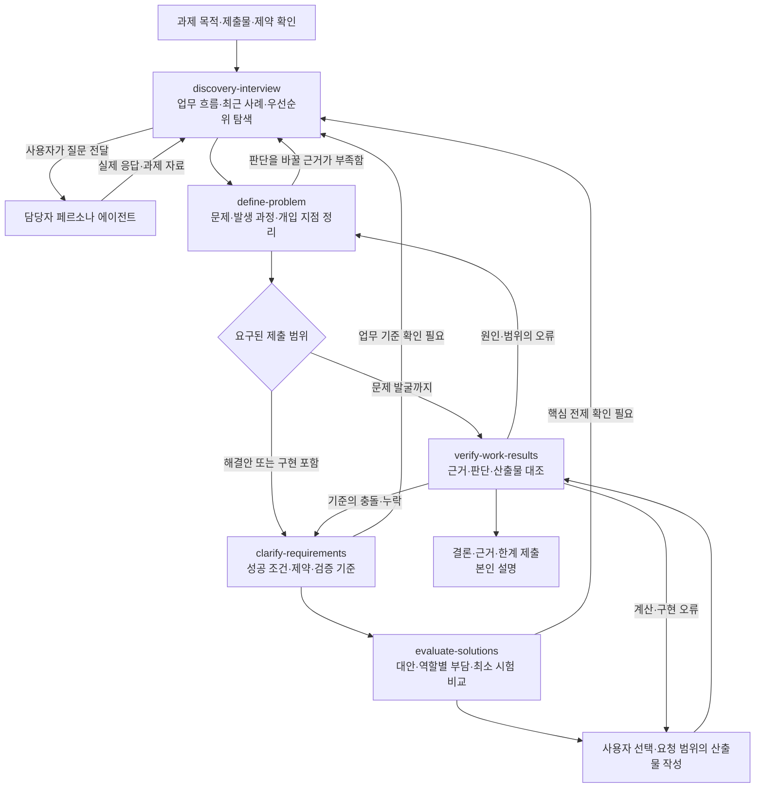

# 담당자 페르소나 인터뷰를 통한 문제 발굴 — Skill Map

작성일: 2026-10-30

담당자 또는 담당자 페르소나와 인터뷰하여 업무 문제를 발굴하는 상황에 적용할 운영안이다. 문제 발굴부터 해결안 비교·결과 검증까지 필요한 단계만 사용한다. 시험·가상 과제에서는 제공된 응답과 자료를 과제 내 근거로 다루고, 도구·자료 사용과 제출 범위는 해당 환경의 지침을 따른다. 공식 출제 유형이나 평가표를 재현한 자료가 아니다.

**핵심 흐름은 ‘근거 확보 ↔ 문제·원인·개입 지점 정의 → 성공 조건 → 대안 선택 → 결과 검증’이다.** 문제 발굴만 요구되면 문제 정의의 근거를 검증하고 제출한다. 대안·구현까지 요구될 때만 그 단계로 확장한다. 다섯 스킬을 매번 처음부터 모두 실행할 필요는 없다.

판단 내용은 **Problem Space → Pain → Mechanism → Opportunity → Solution**으로 연결한다. 업무와 불편을 구분하고, 원인이 불편을 만드는 과정을 설명한 뒤, 바꿀 역할·행동·구조를 특정하고 구체적인 방법을 비교한다. 성공 조건은 이 변화가 만족해야 할 기준이며 Opportunity를 대신하지 않는다.

각 단계의 결과는 정형 Markdown으로 저장하고 다음 단계의 입력에 파일·버전·항목 ID로 연결한다. [입력·출력 규약과 양식](handoff-contract.md), [가상 예제](examples/onboarding/01-discovery.md)를 참고한다.



이 도식은 **작업 순서와 정보 전달 관계**다. 여러 에이전트를 자동 생성하거나 담당자에게 자동으로 메시지를 보내는 구성이 아니다. 선택된 해결책의 업무 효과에 반대 증거가 나오면 `evaluate-solutions`로 돌아가 선택을 재검토한다.

**담당자와 지원 AI의 역할을 나눈다.**

| 역할 | 하는 일 | 근거로 남길 것 |
| --- | --- | --- |
| 나 | 질문 선택·전달, 핵심 판단, 대안 선택, 직접 검증·설명 | 선택 이유, 직접 대조한 사례, 판단 변경 근거 |
| 담당자 페르소나 에이전트 | 과제에서 부여된 업무 사실·경험·제약에 응답 | 실제 발언과 제공 자료. 과제 내 진술·자료로 표시 |
| 분석 지원 AI | 스킬에 따라 질문 보완, 근거 정리, 계산·대안·검증 지원 | 해석·가설·계산·검사와 근거. 담당자 응답을 대신 만들지 않음 |

별도 지원 AI가 허용되는 환경에서는 여기에 스킬을 적용하고, 담당자에게는 자연어 질문을 전달한다. 담당자에게 스킬 이름을 보낸다고 그 환경에 로컬 파일이 로드되는 것으로 가정하지 않는다. 로컬 스킬을 쓸 수 없는 환경에서는 시험 지침에 따라 미리 익힌 질문·판단 순서를 적용한다. 파일 반입이나 지침 붙여넣기가 허용된다고 추정하지 않는다.

**단계별 사용 시점과 넘겨줄 결과는 다음과 같다.**

| 단계·스킬 | 사용하기 좋은 시점 | 이번 단계에서 얻을 것 | 다음 단계로 넘어갈 판단 |
| --- | --- | --- | --- |
| 1. discovery-interview | 불만·요청은 있지만 실제 사건과 부담을 모를 때 | 최근 사례의 흐름, 담당자 표현, 자료·진술 근거, 우선순위와 미확인 | 누구의 어느 장면을 더 살필지 정할 수 있다. 답을 바꿀 질문을 우선한다. |
| 2. define-problem | 여러 답변에서 문제와 개입 지점을 정할 때 | P-ID 문제·Pain, M-ID 발생 과정, O-ID 개입 지점, 범위·반박 조건 | 원인과 개입 방향을 근거 수준에 맞게 연결한다. 미확정이면 잠정 가설로 진행한다. |
| 3. clarify-requirements | 해결안이 만족해야 할 조건을 정할 때 | 성공 조건, 업무 규칙, 제약, 예외, 검증 방법 | 필수 조건과 제안·미확정을 구분하고 충족 여부를 확인할 방법이 있다. |
| 4. evaluate-solutions | 실질적으로 다른 방법 중 선택해야 할 때 | 공통 기준의 비교, 역할별 업무 변화, 최소 시험, 선택 변경 조건 | 사용자가 선택하거나 위임한 범위에서 선택한다. 미결정이면 조건부 추천으로 남긴다. |
| 5. verify-work-results | 문제 정의·계산·제안·구현 결과를 제출하기 전, 또는 중간 핵심 주장 확인 시 | 원자료·기준·기대 판단·실제 결과의 대조, 확인 범위와 불일치 | 필요한 범위의 검증을 수행했고 미실행·판단 불가를 숨기지 않는다. |

`verify-work-results`는 마지막에만 쓰는 스킬이 아니다. 인터뷰에서 얻은 집계나 중요한 사실을 확인할 때도 사용한다. `clarify-requirements`는 **무엇을 만족해야 하는지**, `verify-work-results`는 **실제로 만족했는지**를 담당한다.

| 읽는 입력 | 저장할 출력 | 다음 단계가 이어받는 항목 |
| --- | --- | --- |
| 과제·실제 응답·원자료 | `01-discovery.md` | E/C-ID, 업무 범위·Pain·탐색 단서 |
| 01 또는 직접 근거 | `02-problem-definition.md` | P/M/O-ID, 연결 근거·가설·기대 변화 |
| 02와 업무 규칙 | `03-requirements.md` | R-ID와 P/O 연결, 충족·검증 기준 |
| 02·03과 사용자 우선순위 | `04-solution-evaluation.md` | S/X-ID, 추천·실제 선택, 계획과 재검토 조건 |
| 검토할 단계 문서·산출물·실행 증거 | `05-verification.md` | V-ID, 확인 범위, 수정·돌아갈 지점 |

단계 결과마다 링크와 핵심 결론·확인할 점을 사용자에게 제시한다. 사용한 입력 버전이 달라지면 영향을 확인하고 재검토 필요를 표시한다. 사용자 검토와 선택을 AI가 대신 완료 처리하지 않는다. 이 파일들은 각 스킬이 실행될 때 만드는 사용자 결과이며, HTML에서 단계를 클릭하는 것만으로 생성되지는 않는다.

**실제 인터뷰에서는 다음처럼 움직인다.**

1. 과제에서 오늘 제출할 것이 문제 정의인지, 개선안인지, 실행 가능한 결과물인지 먼저 확인한다. 주어진 규칙·마감·제출 조건은 재질문하지 않고 정리한다.
2. 업무의 앞뒤를 파악한 뒤 최근 구체적인 사례 하나를 고른다. 모든 업무를 같은 깊이로 탐색하지 않는다.
3. 계기 → 필요한 정보·판단 → 실제 확인 경로 → 담당·인계 → 결과를 따라간다. 한 번에 하나의 질문을 전달한다.
4. 여러 불편이 드러나면 중간에 가장 부담이 큰 일과 그 이유를 묻는다. 남은 질문은 해당 문제에 집중한다.
5. 자료·빈도·시간·영향을 확인하고, 원활했던 사례나 다른 이해관계자의 설명과 비교할 수 있는지 살핀다. 자료가 없으면 진술에 근거한 잠정 판단으로 남긴다.
6. 문제 정의 초안을 만들고, 담당자에게 먼저 업무 범위가 맞는지 확인한다. 사건·행동·인계가 어떤 Pain을 만드는지 연결하고, 누구의 어느 행동·구조를 바꿀지 후보를 정리한다. 원인과 영향의 근거·반례를 각각 확인한다.
7. 해결안까지 필요하면 성공 조건·운영 제약을 정하고 대안을 비교한다. 기능 설명에 대한 동의와 실제 필요·효과의 근거를 구분한다.
8. 요구된 산출물을 작성한 뒤 원문·규칙과 대조한다. 마지막 설명에는 선택 이유, 실제 검증 한 건, 미확인 범위와 판단 변경 조건을 포함한다.

최근 사례 하나를 추적하는 것은 출발점이다. 한 사례로 반복성·대표성을 입증하지 않는다. 사례를 무조건 세 건 모으는 규칙보다, 현재 판단을 바꿀 정상·예외·반대 사례가 무엇인지 선택하는 것이 중요하다.

**아래 문장은 스킬을 읽을 수 있는 지원 AI에 전달할 호출 예시다.** 담당자에게 보낼 질문은 지원 AI의 제안을 검토해 자연어로 전달한다. 자동 발견 여부는 실행 환경에 따라 확인하며, 파일을 찾지 못하면 접근 가능한 환경에서 해당 `SKILL.md` 경로를 명시할 수 있다.

```text
$discovery-interview
첨부한 과제와 실제 담당자 응답을 바탕으로 인터뷰를 도와줘.
현재 확보한 근거, 내 가설, 아직 모르는 것을 구분하고
다음에 물을 핵심 질문 하나와 그 질문으로 달라질 판단을 알려줘.
담당자의 답이나 수치를 대신 만들어내지 마.
출력 양식으로 01-discovery.md를 저장하고 근거 E-ID와 사례 C-ID를 남겨줘.
```

```text
$define-problem
지금까지의 응답·자료로 문제 후보를 정리해줘.
대상·상황·어려움·영향·범위와 원인 가설을 구분하고,
현재 가장 다룰 가치가 있는 후보의 근거와
그 판단을 바꿀 추가 증거를 제시해줘.
원인의 발생 과정 M-ID와 개입 지점 O-ID를 연결해 02-problem-definition.md에 저장해줘.
```

```text
$clarify-requirements
선택한 문제에 대해 성공 조건·업무 규칙·제약·예외·검증 기준을 정리해줘.
담당자에게 확인된 조건과 우리 제안, 미확정을 구분해줘.
산출물이 제대로 동작하는 조건과 업무 효과를 확인하는 조건을 나눠줘.
P/O-ID와 요구 R-ID를 연결해 03-requirements.md에 저장해줘.
```

```text
$evaluate-solutions
이 문제와 조건을 바탕으로 실질적으로 다른 대안을 비교해줘.
각 역할의 줄어드는 일과 새로 생기는 일을 포함하고,
핵심 가정을 확인할 최소 시험과 선택을 바꿀 조건을 제안해줘.
이번 과제에서 요구한 제출 범위에 맞춰줘.
각 S-ID가 어떤 M/O/R-ID에 대응하는지와 X-ID 실험 계획을 04-solution-evaluation.md에 저장해줘.
```

```text
$verify-work-results
제출 초안을 실제 응답·자료·규칙과 대조해줘.
개별 판단과 전체 집계를 나눠 확인하고, 기대값의 도출 근거를 남겨줘.
업무 원기록 대조, 합성 기능 시험, 운영 효과 확인을 구분해줘.
내가 직접 확인한 것과 AI만 확인한 것, 아직 검증하지 못한 것을 밝혀줘.
입력 버전·대상 ID·V-ID 대조 결과와 돌아갈 지점을 05-verification.md에 저장해줘.
```

학습·복기할 때는 마지막 요청에 다음을 추가할 수 있다.

```text
설명 연습 모드로 진행해줘.
내가 먼저 목적·선택 이유·검증 사례·한계를 설명하면,
최초 답변을 보존하고 빠진 근거나 논리를 피드백해줘.
```

**짧은 예시 — ‘진행 상태 문의를 자동화하고 싶다’는 요청을 받았을 때.** 아래는 사용법을 보여주는 예시이며 실제 시험 담당자의 응답이 아니다.

| 현재 상태 | 적용할 스킬·질문 | 남길 판단 |
| --- | --- | --- |
| 자동 알림 요청만 있다. | discovery-interview: “가장 최근에 진행 상태를 다시 확인했던 일을 하나 말씀해 주세요.” | 기능 선호와 실제 사건을 구분한다. |
| 담당자가 “기록은 있는데 갱신이 늦다”고 답했다고 가정한다. | discovery-interview: “그 건의 상태가 바뀐 것을 처음 안 사람은 누구였나요?” 이후 기록 시점·담당을 별도 질문한다. | 갱신 책임·시점 문제인지 확인한다. 발언만으로 원인을 확정하지 않는다. |
| 확인 경로와 부담의 근거가 생겼다. | define-problem | P-ID 부담 → M-ID 갱신 지연의 발생 과정 → O-ID 최초 인지자와 판단자 사이 갱신·전달 지점 개선을 연결한다. 가설·미확인을 보존한다. |
| 대안을 제시해야 한다. | clarify-requirements | 최신 상태를 판단할 수 있어야 한다는 조건과 갱신 부담·권한·기한을 정리한다. |
| 공통표·담당 규칙·알림을 비교한다. | evaluate-solutions | 잘못되거나 오래된 정보를 알림으로 확산할 가능성, 추가 입력 업무, 작은 시험을 비교한다. |
| 초안에 “문의 10회가 모두 반복 문의”라고 적었다. | verify-work-results | 응답·원자료에서 같은 상태의 재문의인지 확인한다. 확인되지 않으면 반복 문의 10회로 단정한 문장을 고친다. |

**포함된 스킬과 구성.**

| 스킬 | 위치 | 반영 내용 |
| --- | --- | --- |
| discovery-interview | [SKILL.md](../skills/discovery-interview/SKILL.md) | 신규. 사례 추적, 질문 보완, 우선순위, 자료·반례 확보, 담당자와 지원 AI 구분 |
| define-problem | [SKILL.md](../skills/define-problem/SKILL.md) | 발생 과정과 개입 지점 후보를 분리하고 P/M/O-ID로 연결 |
| clarify-requirements | [SKILL.md](../skills/clarify-requirements/SKILL.md) | 개별 정확성·전체 정합성, 기대값 근거, 산출물 완료·업무 효과 조건 추가 |
| evaluate-solutions | [SKILL.md](../skills/evaluate-solutions/SKILL.md) | 역할별 업무 변화와 효과 비교의 기준값·지표·수집·미완료·판단 조건 추가 |
| verify-work-results | [SKILL.md](../skills/verify-work-results/SKILL.md) | 신규. 원자료 대조, 최신 결과 확인, 검증 종류·주체·범위 구분 |
| 설명 연습 | [learning-mode.md](../skills/verify-work-results/references/learning-mode.md) | 별도 스킬 대신 결과 검증의 선택 모드. 최초 설명 보존과 근거 중심 피드백 |

공개 자료 조사가 별도로 요구되면 사용 가능한 조사 도구를 활용한다. 담당자 과제의 업무 사실을 일반적인 인터넷 자료로 대체하지 않는다. 이 저장소에는 공개 자료 조사 전용 스킬을 포함하지 않는다.

이 흐름은 개인 학습·실습 기록과 인터뷰 피드백에서 반복된 강점·개선점을 바탕으로 정리했다. 개인 원기록은 저장소에 포함하지 않는다. 이 문서는 재사용할 절차와 호출 예시를 제공한다.

[HTML 스킬맵](skill-map.html)에서는 제출 범위 전환, 단계별 설명과 호출 문장 복사, 인쇄용 보기를 사용할 수 있다. HTML 파일을 내려받거나 저장소를 복제한 뒤 브라우저에서 연다. GitHub 파일 화면에서는 HTML 소스가 표시된다.

[스킬별 흐름·양식 HTML](skill-guide.html)에서는 각 스킬의 내부 진행 흐름, 정형 MD 출력 양식, 가상 작성 예제와 스킬 원문을 함께 확인할 수 있다. 양식·예제·원문을 Markdown으로 복사하거나 내려받을 수 있다.
