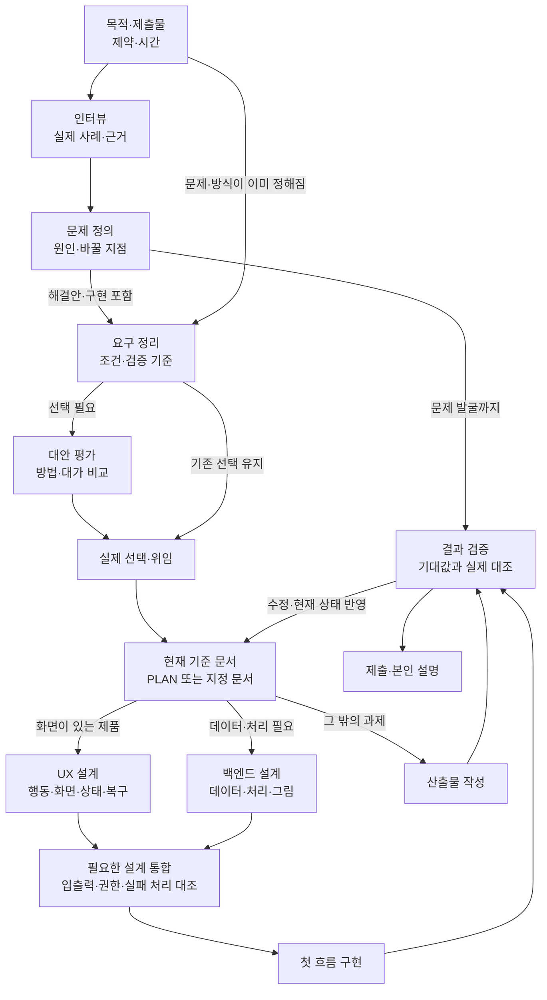

# Skill Map — 사용 시점·흐름·입출력

갱신일: 2026-11-04

필요한 단계부터 시작한다. 문제 발굴만 요청되면 그 근거를 검증하고 마무리하며, 해결안·구현까지 요청된 경우에만 확장한다. 일곱 스킬을 모두 순서대로 실행할 필요는 없다. 앞 단계 파일 없이 과제 원문·실제 응답·직접 자료로 시작할 수 있다.

판단은 **업무 범위 → 불편과 영향 → 발생 과정 → 바꿀 지점 → 요구·해결 방식**으로 연결한다. 이 흐름은 공식 출제 유형·평가표가 아니다. 가상 담당자 응답은 과제 내 진술이며 실제 기업의 현장 증거로 표현하지 않는다.

## 전체 흐름



이 도식은 작업·정보 전달 관계다. 자동 에이전트 생성·외부 연락의 지시가 아니다. 새로운 증거가 원인·업무 범위를 바꿀 때만 문제 정의로 돌아간다. 구현 오류는 해당 구현으로, 기준 충돌은 해당 요구로 돌아간다.

## 저장 방식과 입출력

여러 단계를 수행하는 새 과제의 기본은 **기준 문서 한 곳에 현재 판단을 직접 쓰는 것**이다. 단독 스킬 사용, 긴 상세 근거, 별도 제출 의무가 있을 때만 오른쪽의 파일을 만든다. 기존 문서를 원본으로 유지하면 기준 문서에는 핵심·링크만 두고 전체 표를 복사하지 않는다. [전달 규약](handoff-contract.md) · [PLAN·제출본 역할](development-handoff.md)

| 스킬 | 필요한 입력 | 기준 문서에 반영할 내용 | 단독·상세 분리 시 기본 파일 |
| --- | --- | --- | --- |
| discovery-interview | 과제·실제 응답·업무자료 | 근거·업무 맥락, E/C-ID | `01-discovery.md` |
| define-problem | 실제 근거·업무 범위 | 문제·발생 과정·개입 지점, P/M/O-ID | `02-problem-definition.md` |
| clarify-requirements | 목적·원문·규칙·실제 결정 | 요구·기대 결과·미결정 분류, R-ID | `03-requirements.md` |
| evaluate-solutions | 문제·요구·우선순위·위임 | 대안 비교 핵심·선택 이유·대가, S/X-ID | `04-solution-evaluation.md` |
| design-ux | 사용자 과업·요구·선택·기존 화면 | 사용자 흐름·화면별 행동·상태·복구·공유 입출력 | `ux-design.md` |
| design-backend | 요구·입출력 규격·선택·기존 코드 | 데이터·처리·상태·권한·Mermaid 설계 | `backend-design.md` |
| verify-work-results | 대상·버전·원자료·규칙·실행 증거 | 현재 판정·증거·한계, V-ID | `05-verification.md` |

단독·상세 출력의 기본 폴더는 `docs/artifacts/`이며 위 표의 파일을 바로 아래에 저장한다. 작업명별 하위 폴더는 만들지 않고, 폴더는 첫 산출물이 필요할 때 만든다. 같은 산출물은 기존 파일을 갱신하고 다른 산출물과 이름이 겹칠 때만 파일명에 대상을 붙여 구분한다. 사용자 지정 형식·경로와 기존 문서의 관리 위치가 우선하며, 단독 사용을 위해 PLAN이나 다른 단계 파일을 생성하지 않는다. 출력 양식은 필요한 판단 항목의 참고 자료다. 사용자 검토·가설·미확인·실제 선택 상태와 입력 버전·기존 ID는 저장 방식과 무관하게 유지한다.

기존 산출물의 보강은 PLAN·단독 문서 모두 관련 절·문단·표에 통합한다. 각 스킬의 출력 규칙과 [공통 문서 위계 규칙](../templates/AGENTS.template.md#보강수정-시-문서-위계-유지)에 따라 기존 구조와 ID를 유지하고, 영향받는 요약·상세 근거·검증 상태를 함께 확인한다.

## discovery-interview — 실제 사례와 변경 상황 확보

[스킬](../skills/discovery-interview/SKILL.md) · [출력 양식](../skills/discovery-interview/assets/output-template.md)

- **사용 시점:** 불편은 들었지만 실제 행동·영향·자료를 모를 때. 준비·진행 중 질문·사후 분석 중 요청한 범위만 수행한다.
- **흐름:** 업무 구간 고정 → 최근 사례의 계기·행동·인계·결과 추적 → 다른 설명·예외 확인 → 근거와 다음 질문 정리.
- 반복 서비스에서는 최근 확정 결과를 바꾼 사례의 주체·시점·기존 이용자에게 반영된 결과도 확인한다. 이력·승인·공지 필요성을 먼저 가정하지 않는다.
- **넘어갈 기준:** 누구의 어느 장면을 더 살필지 근거로 정할 수 있다. 추가 질문이 판단을 바꾸지 않으면 멈춘다. 한 사례의 대표성·자료 없는 수치는 미확인으로 남긴다.
- **다음:** 문제 정의 또는 중요한 주장에 대한 중간 검증.

## define-problem — 문제·발생 과정·바꿀 지점

[스킬](../skills/define-problem/SKILL.md) · [출력 양식](../skills/define-problem/assets/output-template.md)

- **사용 시점:** 근거에서 문제의 대상·원인·개입 범위를 좁힐 때.
- **흐름:** 대상·불편·영향 → 사건·조건에서 Pain까지의 발생 과정 → 바꿀 역할·행동·구조 → 반박 조건·다음 판단.
- 원인 이름을 인과 증거로, 특정 기능을 개입 지점으로 대신하지 않는다. 원인이 잠정이면 이후 판단도 그 상태를 유지한다.
- **넘어갈 기준:** 현재 근거가 지지하는 문제·원하는 결과·범위가 분명하다. 원인 입증 완료를 모든 진행의 조건으로 두지 않는다.
- **돌아갈 때:** 새 증거가 대상·원인·범위를 바꿀 때만 해당 부분 재검토. 구현 질문·결함마다 전체 정의를 다시 하지 않는다.

## clarify-requirements — 완료 기준과 정리 종료

[스킬](../skills/clarify-requirements/SKILL.md) · [출력 양식](../skills/clarify-requirements/assets/output-template.md)

- **사용 시점:** 관찰 가능한 성공 조건·제약·입출력·예외를 정할 때. 이미 선택한 해결책의 구체화에도 쓴다.
- **흐름:** 원문·규격·기존 선택 확인 → 필수 동작·예외·출처 → 독립 기대값·검사 방법 → 누락·충돌과 미결정 분류.
- 미결정은 **착수 차단 / 구현 중 결정 / 후속 후보**로 나누고 처리 시점·지금 가능한 범위를 적는다. 최초 생성 외에 변경·재실행·실패 후 기대 동작도 관련 있을 때 다룬다.
- **넘어갈 기준:** 첫 흐름의 필수 동작·핵심 기대 결과·차단 결정 처리 방법이 정리됐다. 문장 다듬기·모든 기술값 확정을 기다리지 않는다.
- **다음:** 필요한 대안 선택 또는 선택을 유지한 최소 설계·구현. 검증 기준 작성은 실제 검증 완료가 아니다.

## evaluate-solutions — 선택의 이유와 대가

[스킬](../skills/evaluate-solutions/SKILL.md) · [출력 양식](../skills/evaluate-solutions/assets/output-template.md)

- **사용 시점:** 여러 방법의 효과·부담·위험이 선택을 바꿀 때.
- **흐름:** 실질적으로 다른 방법 → 같은 기준의 요구 충족·역할별 부담 → 조건부 추천·실제 선택 → 중요한 불확실성을 줄일 작은 시험.
- 소프트웨어에서는 변경 반영 시점·기존 결과 영향·복구·구현/검증 비용도 비교한다. 즉시 교체와 별도 적용은 예시이며 초안/운영본 기능을 자동 추가하지 않는다.
- **넘어갈 기준:** 실제 선택 또는 위임 근거가 있고 감수할 대가·남은 전제가 드러난다. AI 추천과 선택은 구분한다.
- **다음:** 선택을 현재 기준 문서에 반영하고 요청된 범위로 진행. 제품 방향이 정해진 작은 구현 결정은 전체 비교를 재시작하지 않는다.

## design-ux — 사용자 과업을 화면과 행동으로 연결

[스킬](../skills/design-ux/SKILL.md) · [출력 양식](../skills/design-ux/assets/output-template.md)

- **사용 시점:** 화면이 있는 제품의 첫 과업을 설계하거나 기존 사용자 흐름의 끊김을 검토할 때. 시각 스타일만 바꾸거나 화면이 없는 처리 로직에는 별도 UX 설계를 요구하지 않는다.
- **흐름:** 사용자·진입·완료 조건 → 화면별 정보·행동·전환 → 필요한 로딩·빈 결과·오류·복구 → 데이터·처리 계약 대조 → 첫 확인 시나리오.
- 기본은 사용자 흐름도와 짧은 설명이다. 취소·수정·재시도 시 입력·기존 결과 보존을 요구와 연결하고, 조사하지 않은 사용성을 사실로 쓰지 않는다.
- **넘어갈 기준:** 첫 과업의 정상·중요 실패 경로, 화면 상태·공유 입출력·확인 기준이 정해졌다. 모든 메뉴·시각 스타일·화면을 먼저 완성하지 않는다.
- **다음:** 필요한 처리 설계와 정합성 확인 후 요청된 구현·검증. PLAN의 사용자 흐름과 화면 절을 기본 원본으로 사용한다.

## design-backend — 요구를 동작 구조와 그림으로 연결

[스킬](../skills/design-backend/SKILL.md) · [출력 양식](../skills/design-backend/assets/output-template.md) · [Mermaid 지침](../skills/design-backend/references/mermaid-design.md)

- **사용 시점:** 첫 사용자 흐름 구현 전, 또는 저장·재생성·조회 동작이 모호할 때. 비소프트웨어 과제나 단순 수정에는 단계를 추가하지 않는다.
- **흐름:** 핵심 데이터·키·관계 → 모듈 책임·계산 → 실행 계약·권한 → 저장·실패·변경 조건 → 그림과 독립 기대값으로 검토.
- 기본 산출물에 **Mermaid 처리 흐름도 + 읽는 순서·결정 이유·실패 보존 해설**을 포함한다. 데이터 관계·상태 전이·호출 순서가 핵심이면 ER/상태/시퀀스 그림을 추가한다.
- **넘어갈 기준:** 첫 흐름의 입출력·책임·저장·권한·실패 조건과 첫 검사 기대값이 정해졌다. 모든 API·필드·고급 운영 기능을 먼저 설계하지 않는다.
- **다음:** 요청된 구현·검증. 설계 검토·그림은 실제 동작 증거가 아니다. 학습이 요청되면 한 모듈의 입력→처리→출력→선택 이유→실패 조건을 설명한다.

## UX와 백엔드 설계의 병렬 진행

작은 수정·짧은 조사·간단한 검사는 메인이 직접 수행한다. 병렬 사용이 요청·허용됐어도 자동으로 서브를 만들지 않는다. 작업량이 충분하고 담당 파일·입력·완료 기준을 분리할 수 있으며, 시간 단축이나 독립 검토의 이득이 전달·조율·통합 부담보다 클 때만 나눈다. 첫 과업과 공유 계약이 정해진 UX·백엔드의 독립 부분이 그 대상이 될 수 있다. 명시적인 병렬 실험·역할 지정은 요청 범위를 따른다. 아직 결정되지 않은 업무 정책·권한·실패 처리는 공통 결정으로 남기며 화면 데이터와 서버 응답을 서로 다르게 확정하지 않는다.

메인 에이전트가 PLAN·WORKLOG 작성과 통합을 맡고, 서브에이전트는 배정된 설계·구현·검사를 수행한다. 배정은 스킬별 고정 담당이 아니라 완료 기준이 있는 태스크별로 한다. 목표·입력과 공유 계약 버전·선행 조건·담당 파일·검사 방법·필요한 스킬을 함께 전달한다. 서브는 결과·실행 증거·미해결 사항·PLAN 반영 요약을 메인에게 돌려준다.

전체 대화 대신 해당 태스크의 합의·제약·미결정과 필요한 원문 위치를 전달한다. 서브 수는 필요한 만큼만 두고, 완료·차단·계약 변경 위주로 보고한다. 같은 문서의 반복 출력·중복 검사·잦은 상태 조회를 줄이되 필요한 원문 확인과 최종 통합 검증은 유지한다. 조율 부담이 커지면 결과를 인계받아 작업을 합친다.

서브의 모호함·충돌은 메인에게 전달한다. 메인이 기존 합의·위임을 확인하고 사용자 판단이 필요한 질문만 취합해 묻는다. 답에 의존하는 부분은 보류하며 독립 작업은 계속한다. 메인은 실제 답변을 기록하고 바뀐 기준과 재작업 범위를 관련 서브에 전달한다.

메인이 사용자 행동부터 처리·저장·화면 반영과 실패 후 복구까지 대조한다. 구현 전에는 시나리오를 미실행으로 남기고, 구현 후 개별 검사·모의 응답 확인과 실제 통합 검증을 구분한다. 상세 분리가 필요할 때만 `docs/artifacts/ux-design.md`와 `docs/artifacts/backend-design.md` 등을 사용한다. 병렬 작업 자체가 파일·하위 폴더를 늘리는 이유는 아니다. [메인·서브 역할과 공통 병렬 규칙](../templates/AGENTS.template.md#병렬-설계와-통합)

## verify-work-results — 현재 결과를 실제 기준과 대조

[스킬](../skills/verify-work-results/SKILL.md) · [출력 양식](../skills/verify-work-results/assets/output-template.md)

- **사용 시점:** 주장·계산·설계·구현 결과가 원자료와 기준에 맞는지 확인할 때. 어느 단계에서도 사용할 수 있다.
- **흐름:** 대상 버전·환경·시각·주체·범위 고정 → 독립 기대값 → 실제 대조 → 불일치 수정·재검사·한계.
- 로그인 성공 응답 이후의 보호된 조회, 변경·재생성, 실패 전후 데이터·결과 보존을 관련 위험에 맞춰 확인한다. API/CLI/UI 오류는 각 계약을 따른다.
- **넘어갈 기준:** 실제로 대조한 범위와 불일치·판단 불가·미실행을 구분했다. 문서·모듈·통합·실제 환경 성공을 서로 대체하지 않는다.
- **다음:** 결과를 원본의 검증 절 또는 기존 05에 기록하고 현재 요약 갱신. 수정 후 원래 환경에서 확인하지 못했거나 사용자 재확인이 없으면 그 한계를 보존한다.

## 호출 예시

기준 문서 경로는 실제 과제에 맞춘다. 단독 문서가 필요한 경우 저장 경로를 별도로 지정할 수 있다. 아래 요청은 지원 AI에게 전달하며 담당자에게 자동 발송하는 지시가 아니다.

```text
$discovery-interview
최근 실제 사례와 변경 사례를 바탕으로 다음 핵심 질문과 달라질 판단을 알려줘.
실제 응답·내 해석·미확인을 구분해 현재 기준 문서의 근거 절에 반영해줘.
```

```text
$define-problem
근거가 지지하는 문제·발생 과정·바꿀 지점과 반박 조건을 정리해줘.
이미 정해진 범위는 유지하고 현재 기준 문서의 관련 판단만 갱신해줘.
```

```text
$clarify-requirements
원문 필수·사용자 추가 필수·제안·미확정을 구분하고 독립 기대 결과를 연결해줘.
착수 차단/구현 중 결정/후속 후보를 현재 기준 문서에 적고 정리 종료 여부를 알려줘.
```

```text
$evaluate-solutions
선택이 필요한 부분만 같은 기준으로 비교해줘.
역할별 부담·변경 반영·기존 결과 영향·실패 복구와 구현 비용을 살피고
실제 선택 근거와 남은 전제를 현재 기준 문서에 반영해줘.
```

```text
$design-ux
첫 사용자 과업의 진입부터 완료까지 화면별 정보·행동·상태·복구를 설계해줘.
사용자 흐름도와 설명, 필요한 로딩·빈 결과·오류·재시도 동작을 보여줘.
기존 처리 설계와 입력·성공/실패 응답·권한을 대조하고 미확정은 질문해줘.
현재 기준 문서의 사용자 흐름과 화면 절에 반영하고 첫 확인 시나리오를 남겨줘.
```

```text
$design-backend
선택한 첫 흐름의 데이터·모듈 책임·처리·저장·권한·실패 보존을 설계해줘.
Mermaid 흐름도와 짧은 해설, 필요하면 관계도·상태 전이도를 보여줘.
기준 문서의 설계 절을 원본으로 유지하고 첫 검사 기대값을 남겨줘.
```

```text
$verify-work-results
현재 결과를 원문·규칙에서 도출한 기대값과 대조해줘.
대상 버전·실제 환경·주체·흐름·미확인을 먼저 알려주고
판정·증거·수정 후 재검사 결과를 정해진 검증 원본에 반영해줘.
```

학습·복기가 요청된 경우에만 [설명 연습 지침](../skills/verify-work-results/references/learning-mode.md)을 적용한다. 사용자의 최초 설명과 AI 피드백을 구분하며 일반 구현·검증을 답변 대기로 중단하지 않는다.

## 역할·시간·후속 도구

사용자는 중요한 업무 기준·범위 판단, 직접 사용과 본인 설명에 집중한다. 에이전트는 구현·검사·증거 취합·최신 요약·변경 영향 반영을 맡는다. 담당자 응답을 지원 AI가 대신 만들어 근거로 쓰지 않는다. 도구·자료 반입과 허용 범위는 실제 과제 규칙을 따른다.

- [시간 제한 지침](../templates/AGENTS.template.md#시간-제한이-있는-과제): 실제 마감에서 검증·설명·제출 시간 확보, 정리 종료와 첫 실행, 재개 때 남은 시간 갱신.
- [PLAN·개발·제출 연결](development-handoff.md) · [PLAN 양식](../templates/PLAN.template.md) · [Worklog 양식](../templates/WORKLOG.template.md) · [시작·재개 문구](../PROMPTS.md)
- [디자인 연계](../skills/design-skills.md) · [개발 도구 연계](../skills/Development-skill-set.md): 필요한 도구만 사용하고 기존 기록 위치를 유지한다.

셋업은 문서 7개와 핵심 스킬 7개를 기존 항목 보존 방식으로 설치한다. [설치 안내](../README.md#설치와-업데이트). 현재 판단·기록 규칙의 원본은 공통 AGENTS, 스킬별 실행 내용은 각 SKILL.md다.
