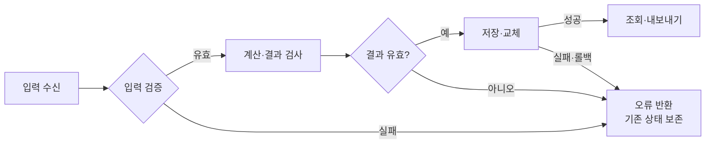
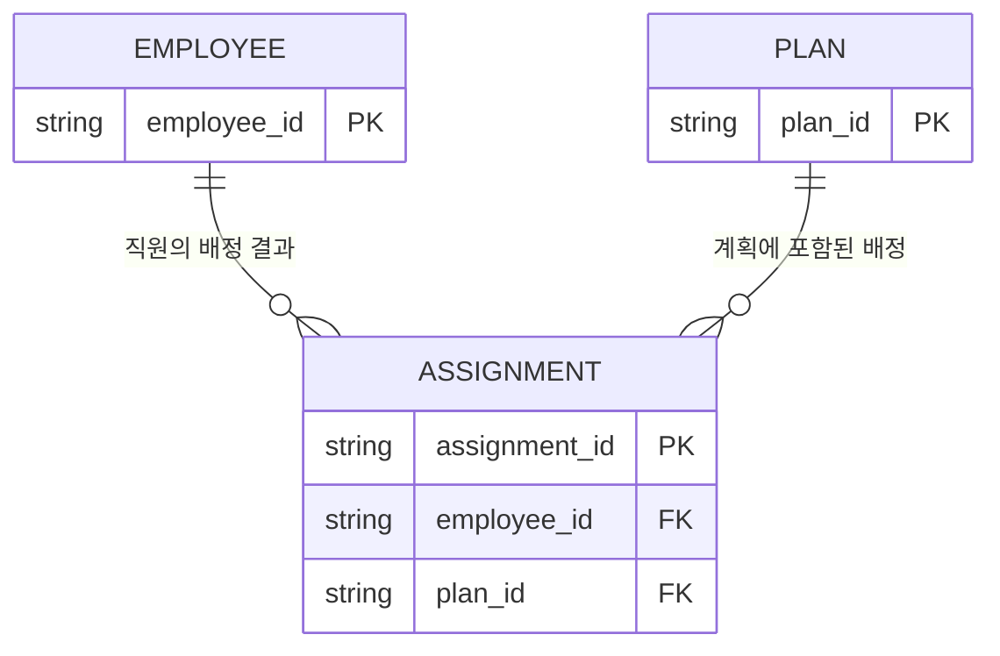

# Mermaid로 설계를 설명하기

기준 문서의 설계 절에 fenced `mermaid` 블록으로 작성한다. 사람이 먼저 흐름을 이해하고 필요한 표로 내려갈 수 있도록 그림을 상세 표 앞에 둔다. 아래는 설명용 예시이며 실제 요구나 구현을 대신하지 않는다.

## 기본: 핵심 처리 흐름

한 그림은 첫 사용자 흐름에 집중한다. 노드 ID는 짧은 영문, 표시 이름은 익숙한 한국어를 사용한다. 복잡한 라벨은 따옴표로 감싼다. 화살표는 처리 순서인지 데이터 이동인지 설명하고 실패 경로도 구분한다.

읽는 순서: 왼쪽 입력에서 시작해 검증·계산이 성공한 경우 저장으로 이동한다. 이 예시는 저장 전체가 성공해야 조회 결과를 교체하는 설계다. 실패 시 이전 결과를 유지하는 요구와 저장 방식이 실제로 있을 때만 이 구조를 사용한다. 새 데이터 저장과 결과 생성이 분리된 과제라면 각각의 저장 경계를 구분해 그린다.

## 추가 그림을 고르는 기준

| 이해하기 어려운 부분 | 그림 | 보여줄 것 |
| --- | --- | --- |
| 엔터티 간 연결·소유 관계 | `erDiagram` | 핵심 키·참조와 1:1/1:N/선택 관계; 확인된 관계만 |
| 기존 결과와 새 결과의 유효성·반영 시점 | `stateDiagram-v2` | 현재 상태·전이 조건·실패 시 남는 상태 |
| 로그인 뒤 조회·권한 검사·저장 호출 | `sequenceDiagram` | 사용자/화면/서버/저장소 등 실제 주체와 요청·응답·실패 분기 |

ER 예시에서 근무일·노선과의 연결이 필요하면 실제 설계에서 확인한 키·카디널리티로 확장한다. 아래 관계를 모든 과제에 그대로 붙이지 않는다.

읽는 순서: 배정 한 건은 직원 한 명과 계획 한 개를 참조한다. 직원·계획은 배정이 없을 수도 있고 여러 건을 가질 수도 있다. 유일성·제외 규칙은 요구와 데이터 표에서 확인한다. 이 그림만으로 중복 배정이 방지된다는 뜻은 아니다.

## 확인과 변경

- 그림의 엔터티·필드·모듈·상태·화살표를 같은 문서의 실제 결정·관련 R-ID와 대조한다. 화살표 하나 때문에 새 승인 절차·서비스·이력 기능을 도입하지 않는다.
- 의미가 달라지는 저장 시점, 권한 경계, 실패 후 상태가 그림과 표에서 같은지 본다. 복잡해지면 한 그림에 모두 넣지 말고 핵심 흐름과 필요한 보조 그림으로 나눈다.
- 사용 환경에서 가능하면 실제 렌더링으로 문법과 읽기 어려운 라벨·교차를 확인한다. 문법 검사만 했다면 시각적 확인과 구분하고, 렌더링할 수 없어도 그림 아래 설명으로 내용을 읽을 수 있게 한다. 검사하지 않은 렌더링을 성공으로 보고하지 않는다.
- 변경은 설계 원본의 그림과 설명에 함께 반영한다. 제출 양식이 Mermaid를 지원하지 않으면 허용된 형식의 이미지·해설로 옮기고 원본 리비전을 연결한다. 별도 그림 파일을 새 설계 원본으로 병행 관리하지 않는다.
